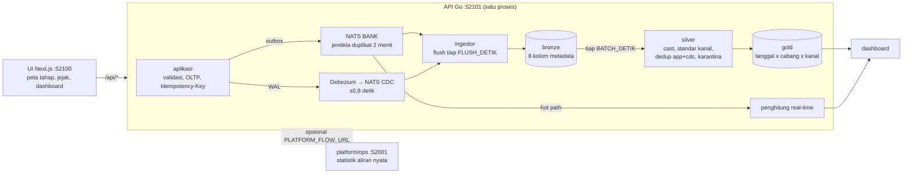

# Lab Bab 1: siklus hidup data, satu transaksi dari aplikasi sampai dashboard

Demo kelas pertemuan 1 (slide `P01-data-engineering-101`, buku Bab 1). Mahasiswa melihat satu transaksi bank
syariah berjalan melewati tujuh tahap, berapa lama di tiap tahap, siapa yang bertanggung jawab, dan
kesalahan data apa yang tertangkap di mana.

## Tujuan

1. Mengenali tahap **data engineering lifecycle** (generation, ingestion, storage, transformation, serving)
   dan undercurrents pada kasus bank syariah digital.
2. Melihat **latensi tiap tahap** secara nyata: milidetik di aplikasi dan NATS, detik di micro-batch
   ingestor, lalu menunggu jadwal batch untuk silver dan gold.
3. Memahami bahwa **data kotor** datang dari sumber yang sah (request dikirim ulang, perangkat offline,
   kode kanal tidak seragam) dan setiap tahap punya tugas menangkap jenis kesalahan tertentu.
4. Membedakan **peran** data engineer, analytics engineer, data analyst, dan data scientist, serta
   **hot path** vs **cold path** dan tier hot/warm/cold/archive.

Kaitan slide P01: "Siapa mengerjakan apa", "Data engineering lifecycle", "Lima tahap, satu contoh",
"Empat tier dan cost-nya", "Dua jalur dalam satu arsitektur", "Medallion: bronze, silver, gold".

## Arsitektur

Lab ini berjalan sendiri (dua container, ±40 MB RAM). Semua tahap dijalankan sungguhan oleh API Go di
memori dengan skema yang sama dengan platform (`platform/KONTRAK-DATA.md`): tabel `transaksi`, event
`bank.transaksi.dibuat` di stream `BANK`, envelope CDC di stream `CDC`, bronze dengan 8 kolom metadata,
silver bertipe benar, gold agregat per tanggal x cabang x kanal.



Pada platform penuh, tahap yang sama dijalankan oleh komponen sungguhan: aplikasi Sister (Go + PostgreSQL),
NATS JetStream, Debezium Server, ingestor Python yang menulis Parquet ke RustFS, dan DAG Airflow harian.
Lab ini memadatkan jadwal Airflow dari harian menjadi 15 detik agar perjalanan satu transaksi selesai di
depan kelas.

## Menjalankan

```bash
cd bab01-data-engineering-101
cp .env.example .env        # BIND_ADDR=10.100.21.22 di server lab
docker compose up -d --build
# UI:  http://<BIND_ADDR>:52100
# API: http://<BIND_ADDR>:52101/api/status
```

Uji otomatis dari keadaan bersih (build, up, 23 cek, lalu `down -v`): `bash uji.sh`.

Bila platform sedang menyala, isi `PLATFORM_FLOW_URL` (mis. `http://10.100.21.22:52001`) lalu
`docker compose up -d`; halaman Dashboard menampilkan statistik stream NATS dan bronze dari platform.

## Skenario demo di kelas (±20 menit)

1. **Buka peta** (`/`). Tunjukkan tujuh kotak dan label tahap lifecycle di atasnya. Tanyakan: tahap mana
   yang menjadi tanggung jawab data engineer? (kotak bertuliskan peran.) Generator latar dalam keadaan mati.
2. **Satu transaksi bersih.** Pilih kanal `"Mobile Banking"`, nominal 250000, klik **Kirim**. Jejak terpilih
   otomatis. Amati kotak menyala berurutan: aplikasi (mikrodetik), event aplikasi (milidetik), CDC
   (ratusan milidetik), bronze (menunggu flush 5 detik), silver dan gold (menunggu batch 15 detik), lalu
   dashboard. Garis waktu di bawah memakai skala logaritmik; bacakan latensi ujung ke ujung.
3. **Wujud data di tiap tahap.** Gulir ke lima panel JSON. Bandingkan baris OLTP (tipe benar), event
   aplikasi (semua string, waktu +07:00), envelope CDC (epoch mikrodetik), dua baris bronze (`_source` app
   dan cdc, 8 kolom metadata), dan satu baris silver (kanal menjadi `mobile`, `sumber: [app, cdc]`).
   Pesan: satu transaksi tercatat dua kali di bronze, dan silver yang menyatukannya.
4. **Kesalahan yang ditolak di sumber.** Pilih occurred_at "30 menit di masa depan" lalu Kirim: HTTP 400
   di kotak aplikasi. Pilih jenis `tarik` dengan nominal 999999999999: HTTP 409. Ini validasi milik tim
   aplikasi, bukan data engineer.
5. **Kesalahan yang lolos dari sumber.** Kirim berturut-turut dan amati kotak silver:
   - nominal dikosongkan → `nominal kosong` (karantina);
   - kanal `"qris"` → `kanal tidak dikenal` (karantina);
   - "request dikirim dua kali, tanpa Idempotency-Key" → dua transaksi tercatat; silver menandai
     `dugaan duplikat bisnis`. Ulangi dengan Idempotency-Key: aplikasi hanya mencatat satu;
   - centang "ack ingestor hilang": bronze menerima baris kembar, silver membuang `duplikat event_id`;
   - centang "publish event diulang": NATS membuang pesan kedua (kotak event aplikasi);
   - occurred_at "26 jam lalu" → flag `data terlambat`. Buka Dashboard: batang tanggal kemarin bertambah.
6. **Hot path vs cold path** (halaman Dashboard). Nyalakan generator 10 trx/detik, kotor 20%. Bandingkan
   tiga batang: hot path naik tiap detik, bronze mentah kira-kira dua kali gold, gold baru melompat setiap
   batch. Rekonsiliasi silver vs gold harus "cocok". Ubah "batch tiap" menjadi 60 detik dan perhatikan
   kesegaran gold memburuk.
7. **Peran dan tier** (halaman Peran). Tutup dengan tabel peran dan empat tier sebagai jembatan ke Bab 2
   (bentuk data) dan Bab 3 (storage dan cost).

## Pertanyaan diskusi

1. Mengapa bronze menyimpan semua baris apa adanya, termasuk duplikat dan nominal kosong? Apa ruginya
   bila ingestor langsung membuang baris yang "salah"?
2. Duplikat bisnis (request ulang tanpa Idempotency-Key) tidak dihapus silver, hanya ditandai. Mengapa?
   Siapa yang seharusnya memperbaiki akar masalahnya?
3. Direksi meminta angka transaksi hari ini "secepat mungkin". Angka hot path atau gold yang Anda berikan,
   dan apa catatannya?
4. Transaksi yang tercatat 26 jam terlambat masuk ke partisi kemarin. Laporan kemarin yang sudah dikirim
   menjadi salah. Bagaimana pipeline harian menangani ini (petunjuk: overwrite partisi, Bab 4–6)?
5. Tahap mana yang paling menentukan latensi ujung ke ujung di lab, dan di platform yang memakai DAG harian?

## Port

| Port | Service | Keterangan |
|---|---|---|
| 52100 | `ui` (Next.js) | peta tahap, jejak, dashboard, peran |
| 52101 | `api` (Go) | `/api/status`, `/api/transaksi`, `/api/jejak/{id}`, `/api/dashboard`, `/api/konfig`, `/api/batch`, `/api/reset`, `/api/platform` |

Semua port diikat ke `${BIND_ADDR}`.

## Log

API menulis log JSON satu baris (`time`, `level`, `msg`, `service=bab01-api`, `request_id`). Polling GET
dari UI tidak dicatat agar log tidak banjir; POST (kirim transaksi, ubah konfigurasi, reset) dicatat.

- Langsung: `docker compose logs -f api`
- Grafana (`shared/observability`, port 52900): dashboard "Log per demo", pilih
  `compose_project = de-bab01`, atau Explore dengan `{compose_project="de-bab01"} | json`.

## Pembersihan

```bash
docker compose down -v
docker image rm de-bab01-api:1.0 de-bab01-ui:1.0   # bila ingin membebaskan disk
docker builder prune -f
```

## Struktur

```
bab01-data-engineering-101/
  compose.yaml  .env.example  uji.sh  README.md
  api/   main.go (HTTP, log), pipeline.go (tahap, aturan silver, gold), data.go (cabang/nasabah/rekening),
         pipeline_test.go, Dockerfile
  ui/    app/page.tsx (peta + jejak), app/dashboard, app/peran, components/grafik.tsx, Dockerfile
```
