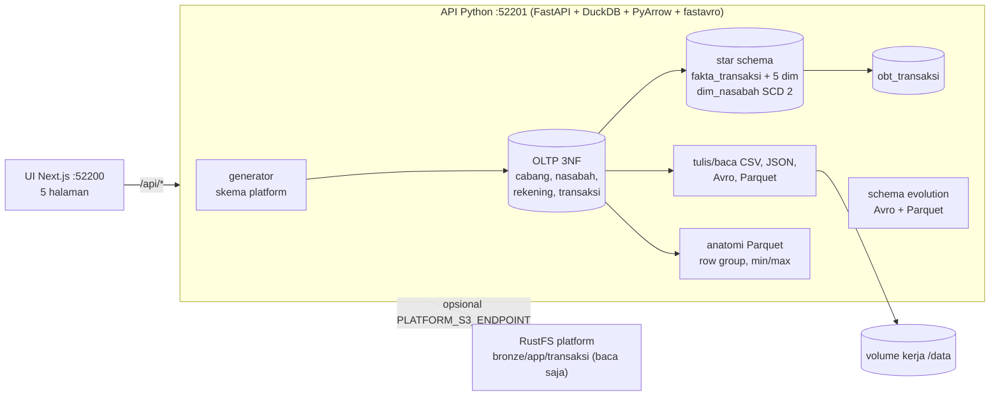

# Lab Bab 2: pemodelan data dan format file

Demo kelas pertemuan 2 (slide `P02-pemodelan-data-dan-format`, buku Bab 2). Dengan data bank yang sama,
mahasiswa membandingkan model OLTP ternormalisasi, star schema, dan one big table; melihat akibat SCD tipe 1
dan tipe 2 pada laporan; lalu mengukur CSV, JSON, Avro, dan Parquet, membuka isi berkas Parquet, dan
menguji aturan schema evolution.

## Tujuan

1. Menulis pertanyaan analitik yang sama untuk tiga model dan membandingkan jumlah join, kedalaman join,
   waktu query, serta kebenaran hasil.
2. Memahami **SCD tipe 1 vs tipe 2** dengan kasus slide: nasabah 7712 pindah dari Bogor ke Bandung pada
   1 Juli 2026, dan dampaknya ke laporan per kota.
3. Mengukur ukuran berkas, waktu tulis, dan waktu baca lima format, serta membedakan row-based dan columnar.
4. Melihat **row group, column chunk, statistik footer**, dan bagaimana **column pruning** serta
   **predicate pushdown** mengurangi byte yang dibaca, termasuk kapan pushdown gagal (data tidak terurut).
5. Membuktikan perubahan skema mana yang aman (backward/forward) dengan Avro schema resolution dan Parquet
   `union_by_name`.

Kaitan slide P02: "Normalization", "Empat langkah Kimball", "Star schema: transaksi rekening",
"Dimensi, surrogate key", "Nasabah pindah kota", "SCD tipe 2 dalam tabel", "Data Vault dan one big table",
"Lima format", "Di dalam file Parquet", "Tiga trik", "Memilih format", "Schema evolution", Praktikum 1 dan 2.

## Arsitektur



Data sintetis memakai kolom yang sama dengan platform (`platform/KONTRAK-DATA.md`): 8 cabang yang sama,
nasabah dengan `kota`/`segmen`, rekening `tabungan_wadiah`/`giro`/`deposito_mudharabah`, transaksi dengan
kanal berbobot seperti generator platform. Sekitar 12% nasabah pindah kota sekali dalam setahun (bahan
SCD 2), dan nasabah 7712 selalu ada sesuai contoh slide. Data dibangkitkan dengan `hash()` DuckDB sehingga
deterministik untuk ukuran yang sama.

Bila platform menyala, halaman Format dapat memakai bronze transaksi dari RustFS platform sebagai sumber
(isi `PLATFORM_S3_*` di `.env`; hanya membaca).

## Menjalankan

```bash
cd bab02-pemodelan-data-dan-format
cp .env.example .env          # BIND_ADDR=10.100.21.22 di server lab
docker compose up -d --build  # start pertama membangkitkan 300 ribu transaksi (±1 detik)
# UI:  http://<BIND_ADDR>:52200
```

Uji otomatis dari keadaan bersih (24 cek): `bash uji.sh`.

## Skenario demo di kelas (±30 menit)

1. **OLTP vs star schema** (`/`, Pertanyaan 1). Tunjukkan dua diagram: tabel yang disorot adalah yang disentuh
   query. Bacakan SQL tiga model di bagian bawah. Amati: OLTP hanya butuh 1 join karena kanal disimpan di
   transaksi; star butuh 3 join, semuanya langsung ke fakta. Hasil ketiganya sama (kolom "beda dengan star" = 0).
2. **Pertanyaan 2** (per kota nasabah). Join OLTP sekarang berantai transaksi → rekening → nasabah, dan baris
   OLTP disorot: hasilnya **berbeda** dari star schema. Tanyakan mengapa, lalu pindah ke halaman SCD.
3. **Ukuran data.** Klik 2.000 rb; tunggu generator selesai (±5 detik), jalankan lagi. Bahas mengapa di
   DuckDB selisihnya tetap kecil (mesin kolumnar, data di memori) dan mengapa star schema tetap dipilih
   (query mudah dipahami, dimensi menyimpan sejarah).
4. **SCD** (`/scd`). Nasabah 7712: OLTP dan SCD 1 hanya tahu "bandung"; SCD 2 punya dua baris
   (sk 1988 bogor sampai 2026-06-30, sk baru bandung sejak 2026-07-01). Grafik bertumpuk memperlihatkan
   transaksi Nov 2025–Jun 2026 pindah ke Bandung bila memakai SCD 1. Lalu **Pindah kota** ke surabaya mulai
   satu setengah bulan lalu: SCD 2 bertambah satu versi dan fakta sesudah tanggal itu menunjuk sk baru.
   Bagian bawah: dampak ke seluruh laporan per kota (Bogor kurang ±Rp 1,9 M bila memakai SCD 1).
5. **Format** (`/format`). Jalankan perbandingan 200 ribu baris. Bandingkan ukuran (JSON terbesar karena
   nama kolom diulang, Parquet zstd ±17% CSV), waktu agregat dua kolom (Parquet puluhan kali lebih cepat),
   dan `SELECT *` (keunggulan mengecil). Buka panel "Isi berkas apa adanya": CSV tanpa tipe, Parquet biner
   diawali `PAR1`.
6. **Di dalam Parquet** (`/parquet`). Berkas dibagi 12 row group. Dengan "urut occurred_at" dan filter
   30 hari, hanya row group terakhir yang dibaca dan hanya tiga kolom (kotak hijau): ±3% dari berkas.
   Klik **urutan acak**: tidak satu pun row group bisa dilewati. Tambahkan kolom `id` ke SELECT dan lihat
   byte melonjak (kolom id paling besar karena unik). Arahkan kursor ke kotak `kanal` untuk melihat encoding
   `RLE_DICTIONARY`.
7. **Schema evolution** (`/evolusi`). Bacakan tabel dari atas: tambah kolom dengan default terbaca, tanpa
   default gagal, ganti nama gagal kecuali memakai alias, int → string gagal, int → long aman. Bagian Parquet:
   tanpa `union_by_name` kolom `catatan` hilang diam-diam.

## Pertanyaan diskusi

1. Pada Pertanyaan 1, OLTP justru memakai join paling sedikit. Apakah itu berarti OLTP lebih cocok untuk
   analitik? Apa yang terjadi bila nama kanal berubah atau kanal punya atribut baru (kelompok digital/fisik)?
2. Laporan regulator bulan Maret sudah dikirim. Bila dimensi nasabah memakai SCD 1, angka Maret per kota
   berubah setiap kali nasabah pindah. Laporan mana yang harus memakai SCD 2, dan mana yang cukup SCD 1?
3. Pada lab, fakta sesudah tanggal pindah langsung di-rekey ke versi baru. Di produksi, kabar pindah kota
   sering datang terlambat (late-arriving dimension). Apa akibatnya pada fakta yang sudah dimuat?
4. Mengapa urutan data di dalam berkas Parquet menentukan keberhasilan predicate pushdown? Kolom apa yang
   sebaiknya dipakai untuk mengurutkan tabel transaksi bank?
5. Tim aplikasi ingin mengganti nama kolom `kanal` menjadi `saluran`. Apa yang Anda minta dari mereka agar
   pipeline tidak rusak?

## Port

| Port | Service | Keterangan |
|---|---|---|
| 52200 | `ui` (Next.js) | `/`, `/scd`, `/format`, `/parquet`, `/evolusi` |
| 52201 | `api` (FastAPI) | `/api/ringkasan`, `/api/bangkitkan`, `/api/model/banding?q=`, `/api/scd`, `/api/scd/pindah`, `/api/scd/dampak`, `/api/format/jalankan`, `/api/parquet/anatomi`, `/api/evolusi`, `/api/platform` |

## Log

API menulis log JSON satu baris (`time`, `level`, `msg`, `service=bab02-api`, `request_id`, `durasi_ms`).

- Langsung: `docker compose logs -f api`
- Grafana (`shared/observability`, port 52900): `{compose_project="de-bab02"} | json`

## Pembersihan

```bash
docker compose down -v        # termasuk volume kerja berisi berkas format
docker image rm de-bab02-api:1.0 de-bab02-ui:1.0
docker builder prune -f
```

## Struktur

```
bab02-pemodelan-data-dan-format/
  compose.yaml  .env.example  uji.sh  README.md
  api/  app.py (endpoint), data.py (generator, OLTP, star, OBT, SQL tiga model), formats.py (format,
        anatomi Parquet, schema evolution, baca bronze platform), requirements.txt, Dockerfile
  ui/   app/{page,scd,format,parquet,evolusi}, components/{grafik,Skema}.tsx, Dockerfile
```
