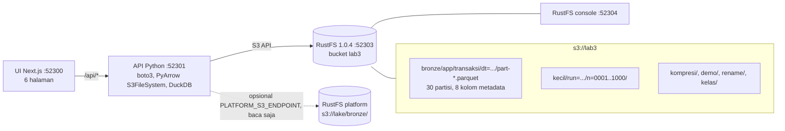

# Lab Bab 3: storage skala besar dan tiering di RustFS

Demo kelas pertemuan 3 (slide `P03-storage-skala-besar-dan-tiering`, buku Bab 3). Mahasiswa bekerja dengan
object storage sungguhan (RustFS 1.0.4, S3-compatible, sama dengan platform): melihat bucket dan key,
mengukur efek partition, small files, dan kompresi, menghitung replication vs erasure coding, lalu
memasang lifecycle policy dan menghitung cost hot/warm/cold/archive.

## Tujuan

1. Memahami model **object storage**: bucket, key, metadata, operasi HTTP (PUT, GET range, HEAD, LIST),
   multipart upload, dan mengapa "ganti nama direktori" mahal.
2. Melihat **partition gaya Hive** (`dt=YYYY-MM-DD`) memangkas berkas yang dibuka query, dan menghitung
   jumlah berkas yang dihasilkan skema partition yang terlalu halus.
3. Mengukur **small files problem** (1, 10, 100, 1.000 berkas untuk data yang sama) dan efek **compaction**.
4. Membandingkan **kompresi** (snappy, lz4, gzip, zstd) dari sisi ruang dan CPU.
5. Menghitung **replication vs erasure coding**: ruang mentah dan peluang kehilangan (model slide).
6. Menguji **kelas penyimpanan** dan **lifecycle policy** di RustFS, menyimulasikan perpindahan tier, dan
   menghitung **cost** simpan, ambil (retrieval) untuk beberapa skenario.

Kaitan slide P03: "Block, file, dan object storage", "Replication vs erasure coding", "Matematika
durabilitas", "Space cost", "Object storage: S3 dan kerabatnya", "Empat tier di dunia nyata", "Lifecycle
policy", "Tiga komponen storage cost", "Hitungan: 10 TB log transaksi disimpan 7 tahun", "Partition gaya
Hive dan masalah file kecil", Praktikum 1 dan 2 (lab ini memakai RustFS sebagai pengganti MinIO).

## Arsitektur



Saat start, API membuat bucket `lab3` dan menulis 30 hari bronze transaksi (20.000 baris per hari) dengan
path dan kolom sesuai `platform/KONTRAK-DATA.md`: `bronze/app/transaksi/dt=YYYY-MM-DD/part-<batch>.parquet`,
kolom `_ingested_at`, `_source`, `_batch_id`, `_event_id`, `_event_type`, `_occurred_at`, `_ts_ms`, `_op`,
lalu kolom transaksi.

### Catatan RustFS 1.0.4 (diuji di lab ini)

- `x-amz-storage-class` hanya menerima `STANDARD` dan `REDUCED_REDUNDANCY`; `STANDARD_IA`, `GLACIER_IR`,
  `GLACIER`, `DEEP_ARCHIVE` ditolak `InvalidStorageClass`.
- Lifecycle dengan beberapa Transition dalam satu rule ditolak ("Only one Transition action per lifecycle
  rule is supported"); satu Transition per rule pun ditolak (`invalid tier`) selama admin belum mendaftarkan
  tier remote. Expiration dan AbortIncompleteMultipartUpload diterima.
- Karena itu perpindahan tier **disimulasikan** dari umur partisi, seperti di platform
  (`platform/README-DATA.md`, bagian Kebijakan tiering). Simulasi dapat menulis tag `tier-simulasi` ke objek.
- DeleteObjects (batch) untuk ribuan objek kecil lambat (±34 detik per 1.000 objek saat diuji), jadi lab
  menghapus objek satu per satu secara paralel dan membersihkan hasil uji small files lama di latar.

## Menjalankan

```bash
cd bab03-storage-skala-besar-dan-tiering
cp .env.example .env          # GANTI S3_ACCESS_KEY/S3_SECRET_KEY; BIND_ADDR=10.100.21.22 di server lab
docker compose up -d --build
# UI:             http://<BIND_ADDR>:52300
# RustFS console: http://<BIND_ADDR>:52304/rustfs/console/
```

Uji otomatis dari keadaan bersih (26 cek): `bash uji.sh`.

Bila platform menyala, isi `PLATFORM_S3_ENDPOINT` (mis. `http://10.100.21.22:52003`) dan kredensial baca
platform di `.env`; halaman Small files menampilkan sebaran ukuran berkas bronze platform yang sebenarnya.

## Skenario demo di kelas (±35 menit)

1. **Object storage** (`/`). Klik folder `bronze/` → `app/` → `transaksi/`: tunjukkan bahwa "folder" adalah
   CommonPrefix hasil LIST dengan delimiter, bukan objek. Klik **Jalankan PUT, HEAD, GET range, LIST**:
   bandingkan latensi tiap operasi, buka detail GET range (`Content-Range: bytes 0-63/...`), dan GET objek
   yang tidak ada (404 `NoSuchKey`). Buka console RustFS di tab lain untuk melihat bucket yang sama.
2. **Multipart dan rename.** Unggah 24 MB: lima bagian, empat dikirim paralel (garis waktu), ETag berakhiran
   `-5`. Lalu **Pindahkan 200 objek**: 401 permintaan HTTP dan beberapa detik untuk satu "rename". Hubungkan
   dengan HDFS (rename = operasi metadata NameNode) dan alasan lahirnya Iceberg.
3. **Partition** (`/partisi`). Klik beberapa tanggal: hanya satu kotak yang menyala, satu berkas dibuka.
   Bandingkan dengan semua partisi (30 berkas, ±30 kali byte). Di kalkulator, isi 1 GB per hari dan bandingkan
   skema `dt` (1 berkas/hari, 1 GB) dengan `dt + jam + cabang + kanal` (960 berkas/hari, ±1 MB) dan
   `dt + rekening` (lencana merah).
4. **Small files** (`/file-kecil`). Jalankan uji 1/10/100/1.000 berkas (±10 detik). Bacakan grafik: tulis,
   LIST, dan baca naik hampir linear dengan jumlah berkas; total byte membengkak karena setiap berkas membawa
   footer; biaya request per bulan (ilustrasi) naik tiga orde. Klik **Compaction 1.000 berkas → 1** dan
   tunjukkan bahwa compaction sendiri mahal (hapus 1.000 objek), sehingga dijadwalkan.
5. **Kompresi** (`/kompresi`). CSV ±24 MB untuk 100 ribu baris; Parquet tanpa kompresi sudah ±60% (encoding
   kolom); zstd level 3 ±17% dengan waktu tulis setara snappy; zstd level 19 lebih kecil lagi tetapi
   puluhan kali lebih lambat menulis. Diskusikan kapan memakai level tinggi (archive).
6. **Replication vs EC** (`/durabilitas`). Geser p ke 10^-3: replication 3× ≈ 10^-9, RS(6,3) ≈ 1,26 × 10^-10
   dengan 1,5× ruang. Ubah volume ke 200 TB: 600 TB vs 300 TB vs 280 TB (angka slide). Tekankan asumsi
   kegagalan saling bebas.
7. **Tiering dan cost** (`/tiering`).
   - Klik **Coba PUT dengan x-amz-storage-class**: hanya STANDARD dan REDUCED_REDUNDANCY diterima.
   - Lihat JSON lifecycle yang dibentuk dari isian, klik **Pasang di RustFS**: percobaan 1 dan 2 ditolak
     dengan pesan aslinya, percobaan 3 (Expiration) diterima.
   - Geser "hari ini" ke 30, 400, 1.100, 3.700 hari: 30 partisi nyata dan 84 kohort bulanan berganti warna.
   - Kalkulator cost: angka bawaan sama dengan slide (10 TB, 7 tahun) → A ≈ Rp 294 jt, B ≈ Rp 50,8 jt.
     Naikkan "dibaca ulang" ke 12 kali per tahun: batang retrieval melonjak, penghematan hilang.

## Pertanyaan diskusi

1. Mengapa `dt` dipilih sebagai kolom partition bronze, bukan `cabang_id` atau `rekening_id`? Kapan
   menambah `cabang_id` sebagai level kedua masuk akal?
2. Ingestor platform menulis micro-batch tiap beberapa detik. Berapa berkas bronze per hari yang terbentuk,
   dan di lapisan mana compaction sebaiknya dilakukan?
3. Tim AI ingin melatih ulang model fraud setiap bulan dengan data tiga tahun. Tier apa yang cocok untuk
   data berumur 13–36 bulan, dan apa akibatnya bila data itu sudah di archive?
4. Erasure coding RS(10,4) lebih hemat daripada RS(6,3). Mengapa tidak selalu dipilih? Pertimbangkan jumlah
   mesin dan rak, serta biaya pemulihan.
5. Retensi 10 tahun di lifecycle policy ditentukan siapa? Apa risikonya bila Expiration dipasang pada
   prefix yang berisi tabel Iceberg?

## Port

| Port | Service | Keterangan |
|---|---|---|
| 52300 | `ui` (Next.js) | `/`, `/partisi`, `/file-kecil`, `/kompresi`, `/durabilitas`, `/tiering` |
| 52301 | `api` (FastAPI) | `/api/objek/*`, `/api/partisi/*`, `/api/kecil/*`, `/api/kompresi`, `/api/kelas/coba`, `/api/lifecycle/pasang`, `/api/tier/simulasi`, `/api/platform/bronze` |
| 52303 | `rustfs` S3 API | endpoint S3 (kredensial dari `.env`) |
| 52304 | `rustfs` console | `/rustfs/console/` |

## Log

API menulis log JSON satu baris (`time`, `level`, `msg`, `service=bab03-api`, `request_id`, `durasi_ms`);
RustFS memakai level `warn`.

- Langsung: `docker compose logs -f api rustfs`
- Grafana (`shared/observability`, port 52900): `{compose_project="de-bab03"} | json`

## Pembersihan

```bash
docker compose down -v        # termasuk volume RustFS
docker image rm de-bab03-api:1.0 de-bab03-ui:1.0
docker builder prune -f
```

## Struktur

```
bab03-storage-skala-besar-dan-tiering/
  compose.yaml  .env.example  uji.sh  README.md
  api/  app.py (S3, partition, small files, kompresi, kelas, lifecycle, simulasi tier, bronze platform),
        requirements.txt (sama persis dengan Bab 2 agar layer pip dipakai bersama), Dockerfile
  ui/   app/{page,partisi,file-kecil,kompresi,durabilitas,tiering}, components/grafik.tsx, Dockerfile
```
