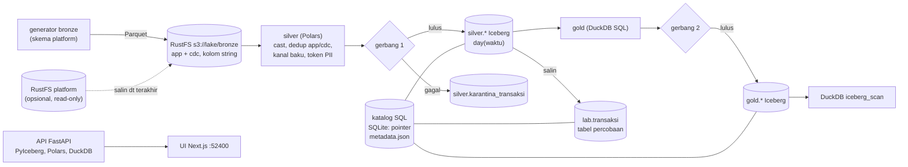

# Lab P04: Lakehouse medallion dan Apache Iceberg di RustFS

Demo kelas pertemuan 4 mata kuliah Data Engineering. Mahasiswa melihat sendiri bagaimana folder Parquet
di object storage menjadi **tabel**: setiap penulisan adalah commit yang membuat snapshot baru, skema dan
partisi dapat berubah tanpa menulis ulang data, tabel dapat diputar ke masa lalu, dan lapisan bronze,
silver, gold masing-masing punya aturan serta gerbang data quality.

Lab ini berjalan sendiri (RustFS + API Python + UI Next.js). Bronze dibangkitkan dengan **skema yang sama
dengan platform** (`platform/ops/SKEMA.md`): 8 kolom metadata, kolom data string, `_before` pada CDC, dan
path `s3://lake/bronze/<app|cdc>/<entitas>/dt=YYYY-MM-DD/`. Aturan silver/gold meniru
`platform/data/pipeline/silver.py` dan `gold.py`.

## Kaitan materi

| Materi | Bagian |
|---|---|
| Buku Bab 4 | §Cara kerja table format (metadata tree Iceberg), §ACID dan commit dengan menukar pointer, §Time travel, rollback, table evolution, §MERGE, copy-on-write, §Perawatan tabel, §Catalog dan query engine, §Medallion architecture, §Membangun medallion di atas Iceberg |
| Slide P04 | Struktur metadata Iceberg; ACID dengan menukar pointer; Time travel dan rollback; Schema evolution; Hidden partitioning dan partition evolution; MERGE; Perawatan tabel; Aturan tiap layer; Satu transaksi melewati tiga layer; Gerbang data quality; Praktikum PyIceberg tanpa JVM dan membaca gold dari DuckDB |
| Platform (contoh UTS) | W2 silver, W3 gold, W5 Iceberg + time travel, W7 overwrite per partisi, W8 gerbang DQ |

## Arsitektur



| Service | Image | Ukuran | Fungsi |
|---|---|---|---|
| `rustfs` | `rustfs/rustfs:1.0.4` | 300 MB (dipakai bersama platform) | object storage S3-compatible, bucket `lake` |
| `api` | `de-bab04-api:1.0` (dari `python:3.12-slim`) | ±1,1 GB (layer pip dipakai bersama bab05) | generator bronze, pipeline medallion, operasi Iceberg, pembacaan pohon metadata |
| `ui` | `de-bab04-ui:1.0` (Next.js 15.5, `node:20-alpine`) | ±215 MB | visualisasi |

Pustaka: PyIceberg 0.12.0 (+ pyiceberg-core), Polars 2.0.0, DuckDB 2.0.0 (ekstensi `iceberg`, `httpfs`
diunduh saat build), PyArrow 26.0.0; versi yang sama dengan platform. Katalog Iceberg memakai
`SqlCatalog` dengan SQLite di volume; platform memakai `SqlCatalog` yang sama di PostgreSQL.

## Menjalankan

```bash
cd bab04-lakehouse-medallion
cp .env.example .env          # ganti kredensial RustFS dan TOKEN_PEPPER; BIND_ADDR=10.100.21.22 di server lab
docker compose up -d --build
# buka http://127.0.0.1:52400
bash uji.sh                   # uji otomatis dari keadaan bersih (±2 menit), diakhiri down -v
```

Saat api menyala pertama kali, bronze 3 hari langsung dibangkitkan (±900 transaksi per hari, 240
nasabah, 8 cabang). Data seluruhnya sintetis.

**Opsional, memakai bronze platform.** Bila platform end-to-end menyala, isi `PLATFORM_S3_ENDPOINT`
(mis. `http://host.docker.internal:52003`) dan kunci RustFS platform di `.env`, lalu jalankan ulang api.
Tombol **Ambil bronze dari platform** muncul di halaman Medallion dan menyalin cabang/nasabah/rekening
serta dua partisi `dt` terakhir transaksi dan akad ke bucket lab. Bucket platform hanya dibaca.

## Halaman UI

| Halaman | Isi |
|---|---|
| Medallion | tombol tambah hari bronze, jalankan pipeline, sisipkan data kotor, pulihkan; diagram bronze → gerbang 1 → silver → gerbang 2 → gold dengan jumlah baris, berkas, snapshot; tabel aturan DQ beserta pelanggar dan contoh baris; isi bronze mentah per entitas; gold; tabel karantina; riwayat run |
| Satu transaksi, tiga lapisan | satu `trx_id` di bronze (dua baris: app dan cdc, semua teks), silver (satu baris bertipe, kanal baku, `_source = app+cdc`), dan baris gold tempat ia dijumlahkan |
| Pohon metadata Iceberg | sepuluh tombol operasi berurutan; linimasa snapshot (operasi, jumlah baris, berkas +/−, skema); pohon katalog → metadata.json → manifest list → manifest → data file, dibaca langsung dari RustFS, simpul baru berbingkai emas; statistik min/maks per berkas; jumlah objek di RustFS vs yang dirujuk snapshot |
| Time travel & pruning | baca tabel pada snapshot lama berdampingan dengan kondisi kini (beserta skema saat itu), tombol rollback; filter `waktu >= tanggal` dan jumlah berkas yang benar-benar dibaca |
| DuckDB atas lakehouse | SQL bebas (hanya SELECT) atas `silver.*`, `gold.*`, `lab.*`; nama tabel diganti `iceberg_scan('<metadata.json terkini>')` |

## Skenario demo di kelas (±25 menit)

1. **Bronze apa adanya** (3 menit). Halaman *Medallion*, kartu *Isi bronze*. Tunjukkan 8 kolom metadata,
   `_source` app dan cdc untuk `id` yang sama, kanal `Mobile Banking`/`m-banking`/`ATM`, nominal bertipe
   String, NIK dan nomor HP mentah pada entitas nasabah. Hubungkan dengan aturan bronze: salinan setia,
   append-only, akses sangat terbatas.
2. **Jalankan pipeline** (3 menit). Klik *Jalankan pipeline*. Amati kartu gerbang 1 (enam aturan: validity,
   completeness, uniqueness, consistency) dan statistik silver: berapa duplikat app vs cdc dibuang, berapa kanal
   dibakukan, berapa transaksi terlambat. Gerbang 2: rekonsiliasi total silver = total gold, referential
   cabang, gold tanpa kolom PII.
3. **Satu transaksi, tiga lapisan** (2 menit). Bandingkan ketiga kolom. Tanyakan: bila logika silver salah,
   dari mana kita membangun ulang? (dari bronze, tanpa menarik lagi dari sumber).
4. **Gerbang menolak data kotor** (4 menit). Klik *Sisipkan data kotor* lalu *Jalankan pipeline*. Gerbang 1
   merah: kanal `satelit`, nominal `dua ratus ribu` dan `-50000`, rekening kosong, nominal app berbeda dengan
   cdc. Gerbang 2 dilewati. Buka *Pohon metadata* dengan tabel `gold.fakta_trx_harian`: snapshot tidak
   bertambah. Pelanggar ada di `silver.karantina_transaksi`. Klik *Pulihkan* dan jalankan lagi.
5. **Pohon metadata** (8 menit), halaman *Pohon metadata Iceberg*, tombol berurutan:
   1. *Salin silver → lab.transaksi*: satu snapshot, satu berkas per hari (partisi `day(waktu)`).
   2. *Append kecil ×5*: lima snapshot, lima manifest dan berkas kecil baru. Katalog hanya menukar pointer
      `metadata_location` (lihat `previous`).
   3. *Compaction*: berkas per partisi menjadi satu. Perhatikan PyIceberg mencatat replace sebagai dua
      snapshot (delete lalu append) dalam satu transaksi; pembaca tidak pernah melihat keadaan di antaranya.
   4. *MERGE*: koreksi nominal dan baris baru; tiga baris BATAL dihapus.
   5. *DELETE kanal = atm*: berkas yang memuat baris itu ditulis ulang (copy-on-write).
   6. *ADD COLUMN*, 7. *RENAME COLUMN*, 8. *Lebarkan tipe*: metadata.json bertambah skema (lihat daftar
      kolom dan nomor field id), data file lama tidak berubah.
   9. *Partition evolution*: spec 1 `day(waktu), bucket[4](rekening_id)`; berkas lama tetap spec 0, berkas
      baru spec 1.

   Di kartu *Objek di RustFS*, data file lebih banyak dari yang dipakai snapshot kini: berkas lama masih
   dirujuk snapshot lama.
6. **Time travel dan rollback** (3 menit). Halaman *Time travel & pruning*: pilih snapshot pertama. Jumlah
   baris dan skema lama (`jenis`, tanpa `kategori_merchant`) berdampingan dengan kondisi kini. Isi tanggal
   terakhir pada filter `waktu`: berkas yang dibaca jauh lebih sedikit (hidden partitioning). Klik
   *Rollback*, lalu kembali ke pohon.
7. **Expire snapshots** (1 menit). Tombol 10: sisa satu snapshot, berkas yatim dihapus, jumlah objek turun.
   Diskusikan kebijakan retensi: audit ingin lama, UU PDP dan biaya ingin singkat.
8. **DuckDB sebagai query engine** (1 menit). Halaman *DuckDB atas lakehouse*, contoh 1–5. Tidak ada server
   warehouse; DuckDB membaca metadata dan Parquet langsung dari RustFS.

## Pertanyaan diskusi

1. Mengapa katalog menjadi satu-satunya bagian yang "boleh berubah"? Apa yang terjadi bila dua penulis
   melakukan commit bersamaan (optimistic concurrency)?
2. Rename kolom tidak menulis ulang data. Bagaimana Iceberg tetap tahu bahwa `jenis_transaksi` adalah kolom
   `jenis` di berkas lama? (petunjuk: field id di pohon metadata)
3. DELETE di lab memakai copy-on-write. Kapan merge-on-read lebih cocok, dan apa akibatnya bagi compaction?
4. Setelah expire, data yang dihapus dari tabel tidak lagi dapat dipulihkan. Bagaimana menyeimbangkan hak hapus
   UU PDP dengan kebutuhan audit reproduksi laporan?
5. Gerbang 1 menghentikan seluruh silver transaksi karena lima baris rusak. Kapan lebih baik mengkarantina baris
   rusak dan melanjutkan sisanya? Apa risikonya bagi rekonsiliasi?
6. Platform memakai partisi identitas `tgl` (tanggal WIB), lab memakai `day(waktu)` (UTC). Apa konsekuensinya
   bagi overwrite per hari dan pruning?

## Port

| Port host | Service | Isi |
|---|---|---|
| 52400 | ui | UI lab |
| 52401 | api | API (JSON, mis. `/api/iceberg/pohon`) |
| 52402 | rustfs | S3 API RustFS |
| 52403 | rustfs | console RustFS (login dengan kunci di `.env`) |

Semua port diikat ke `${BIND_ADDR}`.

## Log

API menulis log JSON satu baris (`time`, `level`, `msg`, `service=bab04-api`, `request_id`). Bila
`shared/observability` menyala, buka Grafana `http://${BIND_ADDR}:52900`, dashboard **Log per demo**, pilih
`compose_project = de-bab04`. Contoh query Loki: `{compose_project="de-bab04", service="bab04-api"} | json | msg="operasi iceberg"`.
Tanpa Grafana: `docker compose logs -f api`.

## Pembersihan

```bash
docker compose down -v        # hapus container, volume RustFS dan katalog
docker builder prune -f       # cache build
```

## Catatan untuk pengampu

- PyIceberg belum punya prosedur `rewrite_data_files`; compaction di lab menulis ulang isi snapshot dalam satu
  commit replace. `expire_snapshots` PyIceberg hanya mengubah metadata, sehingga penghapusan berkas yatim
  dikerjakan API lab (mirip `remove_orphan_files`).
- Overwrite PyIceberg menghasilkan dua snapshot (delete + append) per commit; ini terlihat di linimasa.
- MERGE memakai `Table.upsert` (copy-on-write). Merge-on-read (delete file) belum ditulis PyIceberg; dibahas
  dengan Spark di P9–P10.
