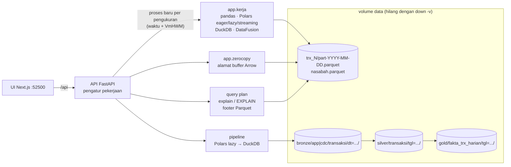

# Lab P05: ETL satu mesin dengan Arrow, Polars, DuckDB, DataFusion, dan pandas

Demo kelas pertemuan 5 mata kuliah Data Engineering. Pertanyaan yang dijawab dengan angka di depan kelas:
perlukah cluster untuk 10 juta transaksi? Mahasiswa melihat transformasi yang sama dijalankan enam cara,
membandingkan waktu dan memori puncak, membaca query plan untuk menemukan predicate dan projection
pushdown, membuktikan zero-copy Arrow lewat alamat buffer, melihat DuckDB tetap selesai dengan memori
terbatas karena menumpahkan data ke disk, dan menjalankan pipeline bronze → silver → gold yang idempotent
seperti di platform.

Lab berjalan sendiri (API Python + UI Next.js, tanpa object storage). Dataset dibangkitkan di volume Docker
dengan skema platform: transaksi (`trx_id`, `rekening_id`, `nasabah_id`, `cabang_id`, `kanal`, `jenis`,
`nominal`, `occurred_at`, ...) dan nasabah; bronze pipeline memakai 8 kolom metadata platform, kolom data
string, dan tumpang tindih app/cdc seperti `platform/data/dev/bangkitkan_bronze.py`.

## Kaitan materi

| Materi | Bagian |
|---|---|
| Buku Bab 5 | §Scale-up dulu, §Apache Arrow (zero-copy, Parquet dan Arrow), §Vectorized execution, §Polars eager dan lazy, §DuckDB, §DataFusion, §Query yang sama di tiga engine, §Pipeline bronze, silver, gold di satu mesin, §Pseudonymization nomor rekening, §Menulis secara idempotent, §Praktik mandiri: pipeline dan benchmark |
| Slide P05 | Apache Arrow; Zero-copy dalam praktik; Polars eager vs lazy; DuckDB SQL atas file; Query yang sama, tiga engine; Bronze → silver dengan Polars lazy; Pseudonymization rekening; Silver → gold dengan DuckDB; Idempotent; Pemeriksaan ringan sebelum menulis; Praktikum (tabel 1 juta/10 juta/memori puncak) |
| Platform (contoh UTS) | jalur ETL `platform/data/pipeline/silver.py` (dedup app vs cdc, token `tok_` SHA-256 + pepper) dan `gold.py` (DuckDB) |

## Arsitektur



| Service | Image | Ukuran | Batas | Fungsi |
|---|---|---|---|---|
| `api` | `de-bab05-api:1.0` (dari `python:3.12-slim`) | ±1,0 GB (layer pip sama dengan bab04) | `mem_limit` 3g, 4 CPU (`.env`) | API, generator dataset, benchmark, pipeline |
| `ui` | `de-bab05-ui:1.0` (Next.js 15.5, `node:20-alpine`) | ±215 MB | 256m | visualisasi |

Pustaka: Polars 2.0.0, DuckDB 2.0.0, PyArrow 26.0.0 (sama dengan platform), pandas 3.1.0, DataFusion 54.1.0,
NumPy 2.5.4. Semua engine dibatasi ke jumlah thread yang sama (`BENCH_CPUS`, default 4).

## Menjalankan

```bash
cd bab05-etl-satu-mesin
cp .env.example .env          # ganti TOKEN_PEPPER; BIND_ADDR=10.100.21.22 di server lab
docker compose up -d --build
# buka http://127.0.0.1:52500
bash uji.sh                   # uji otomatis dengan dataset 1 juta (±3 menit), diakhiri down -v
UJI_BARIS=10000000 bash uji.sh   # versi 10 juta baris
```

Dataset 200 ribu baris dibangkitkan otomatis saat api menyala. Ukuran lain (1, 2, 5, 10 juta) dibangkitkan
dari halaman *Benchmark*; 10 juta baris memakan ±220 MB di volume dan ±40 detik.

## Halaman UI

| Halaman | Isi |
|---|---|
| Benchmark engine | daftar dataset (bangkitkan/hapus); pilih dataset, engine, jumlah ulangan; batang waktu median dan memori puncak per engine dengan garis `mem_limit`; lencana "hasil identik"; tabel praktikum seperti slide (engine × ukuran: ms / MB) |
| Lazy vs eager & query plan | rencana Polars sebelum dan sesudah optimizer, DuckDB `EXPLAIN`, DataFusion `EXPLAIN`, baris pushdown disorot; byte per kolom Parquet (kolom yang dibaca vs tidak); grid row group yang dibaca/dilewati berdasarkan statistik `tanggal` |
| Zero-copy Arrow | langkah Parquet → Arrow → Polars → DuckDB → pandas dengan waktu, tambahan RSS, dan apakah alamat buffer kolom `nominal` sama dengan buffer Arrow asal |
| Batas memori & streaming | query berat GROUP BY `rekening_id`: pandas, Polars eager, Polars streaming, DuckDB dengan `memory_limit`; batang memori dengan garis anggaran dan `mem_limit`, waktu, dan ukuran spill DuckDB |
| Pipeline bronze → gold | bangkitkan bronze app+cdc, jalankan pipeline; dedup (app / cdc / app+cdc), token UDF Python vs DuckDB `sha256` (harus identik), pemeriksaan sebelum menulis, rencana Polars lazy, tabel idempotent (run ke-n: baris silver/gold per tanggal), gold |

## Contoh hasil (server lab, 4 CPU, mem_limit 3 GB, median 3×)

| Engine | 1 juta baris | 10 juta baris | Memori puncak (10 juta) |
|---|---:|---:|---:|
| pandas (`columns=`) | 256 ms | 2.591 ms | 799 MB |
| Polars eager | 290 ms | 1.858 ms | 2.717 MB |
| Polars lazy | 41 ms | 154 ms | 167 MB |
| Polars streaming | 39 ms | 148 ms | 168 MB |
| DuckDB | 83 ms | 276 ms | 113 MB |
| DataFusion | 50 ms | 160 ms | 314 MB |

Query berat 10 juta baris dengan anggaran 512 MB: pandas 2.395 MB, Polars eager 2.578 MB, Polars streaming
900 MB, DuckDB 551 MB dengan spill ±236 MB ke disk (5,6 detik, paling lambat). Angka berubah antar mesin;
yang dibahas di kelas adalah urutan dan alasannya.

## Skenario demo di kelas (±25 menit)

1. **Pertanyaan pembuka** (1 menit). Tanyakan perkiraan mahasiswa: berapa lama agregasi 10 juta transaksi
   di laptop? Perlukah Spark?
2. **Benchmark 1 juta** (5 menit). Halaman *Benchmark engine*, dataset 1 juta, *Mulai* (±20 detik). Amati:
   hasil keenam engine identik; Polars eager paling boros memori karena membaca 13 kolom lalu memfilter;
   lazy/streaming, DuckDB, dan DataFusion jauh lebih cepat. Selama berjalan, jelaskan bahwa setiap ukuran
   diukur di proses baru agar memori puncak tidak tercampur.
3. **Mengapa lazy lebih cepat** (6 menit). Halaman *Lazy vs eager & query plan*. Bandingkan dua rencana Polars:
   `FILTER` di atas `SCAN */13 COLUMNS` berubah menjadi `SELECTION` di dalam scan dan `PROJECT 3/13 COLUMNS`.
   Tunjukkan baris `Filters` di DuckDB dan `pruning_predicate` di DataFusion. Lalu kartu Parquet: hanya ±14%
   byte yang perlu dibaca, dan sepertiga row group dilewati hanya dari statistik di footer.
4. **Skala 10 juta** (4 menit). Bangkitkan 10 juta (±40 detik), jalankan benchmark dengan ulang 1. Waktu
   lazy/DuckDB tetap di bawah setengah detik; Polars eager mendekati garis `mem_limit`. Isi tabel praktikum
   bersama.
5. **Zero-copy** (3 menit). Halaman *Zero-copy Arrow*. `from_arrow(rechunk=False)` dan
   `to_pandas(types_mapper=pd.ArrowDtype)` memakai alamat buffer yang sama (tanpa salin); rechunk dan
   `to_pandas()` ke NumPy menyalin. Kolom string Polars tetap dikonversi ke string view, sesuai catatan slide
   "umumnya tanpa salin".
6. **Batas memori** (3 menit). Halaman *Batas memori & streaming*, 10 juta, anggaran 512 MB. pandas dan Polars
   eager jauh melewati anggaran; Polars streaming lebih hemat; DuckDB bertahan di sekitar anggaran dengan
   menumpahkan ratusan MB ke disk dan membayar dengan waktu. Bila `BENCH_MEM_LIMIT` diturunkan ke `2g`,
   pandas dan Polars eager dibunuh OOM killer dan UI menampilkannya.
7. **Pipeline** (3 menit). Halaman *Pipeline bronze → gold*: bangkitkan bronze 300.000, jalankan dua kali.
   Dedup app vs cdc mengembalikan tepat 300.000 transaksi; `_source` mencatat asalnya. Token UDF Python dan
   DuckDB identik. Tabel idempotent: run 1 dan run 2 memberi jumlah baris yang sama per tanggal.

## Pertanyaan diskusi

1. Polars eager dan pandas sama-sama "eager". Mengapa pandas di sini memakai memori lebih kecil daripada Polars
   eager? (petunjuk: `columns=` di `read_parquet`)
2. Pada data sebesar apa satu mesin tidak lagi cukup? Hitung dari angka memori puncak dan ukuran Parquet.
3. Spill ke disk membuat DuckDB selesai, tetapi lebih lambat. Kapan Anda memilih menambah RAM, kapan streaming,
   kapan cluster?
4. Token rekening dibuat dengan SHA-256 dan pepper. Mengapa ini pseudonymization, bukan anonymization, menurut
   UU PDP? Apa yang terjadi bila pepper bocor?
5. Pipeline menulis partisi lewat folder sementara lalu `os.replace`. Apa yang terjadi bila proses mati di
   tengah? Bandingkan dengan overwrite partisi di Iceberg (P04).
6. Mengapa angka benchmark harus median beberapa kali jalan, dan apa pengaruh cache halaman OS?

## Port

| Port host | Service | Isi |
|---|---|---|
| 52500 | ui | UI lab |
| 52501 | api | API (JSON, mis. `/api/info`, `/api/job`) |

Semua port diikat ke `${BIND_ADDR}`.

## Log

API menulis log JSON satu baris (`time`, `level`, `msg`, `service=bab05-api`, `request_id`), termasuk progres
benchmark. Bila `shared/observability` menyala, buka Grafana `http://${BIND_ADDR}:52900`, dashboard **Log per
demo**, `compose_project = de-bab05`. Contoh: `{compose_project="de-bab05"} | json | msg="progres"`. Tanpa
Grafana: `docker compose logs -f api`.

## Pembersihan

```bash
docker compose down -v        # hapus container dan volume (semua dataset benchmark ikut terhapus)
docker builder prune -f
```

## Catatan untuk pengampu

- Batas memori per proses tidak bisa dipasang dengan `RLIMIT_AS` (OpenBLAS dan DuckDB gagal pada alokasi
  virtual besar), sehingga demo batas memori memakai `memory_limit` DuckDB, perbandingan terhadap garis
  anggaran, dan `mem_limit` container sebagai batas keras.
- Waktu import pustaka tidak ikut diukur (dicatat terpisah sebagai `import_ms` di API).
