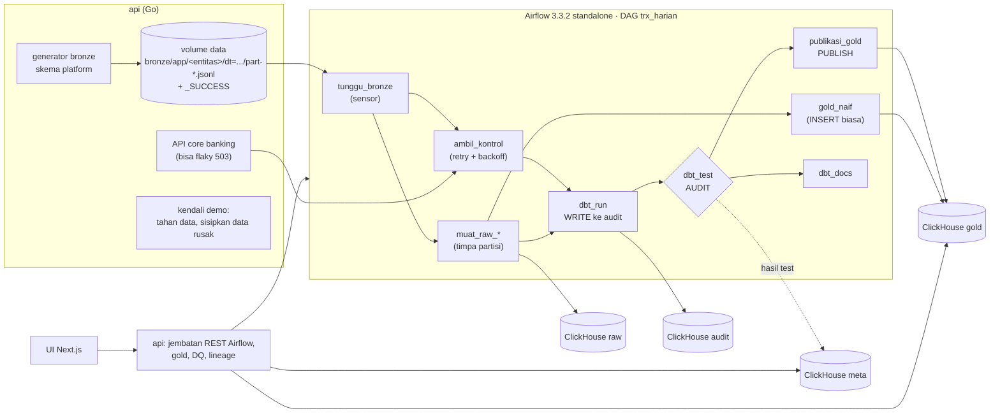

# Lab P06: orkestrasi Airflow, dbt, dan data quality

Demo kelas pertemuan 6 mata kuliah Data Engineering. Lab ini memperlihatkan pipeline harian transaksi bank
syariah yang diatur Apache Airflow, ditransformasi dbt di ClickHouse, dan dijaga gerbang data quality dengan
pola write-audit-publish. Lab berdiri sendiri: bronze sintetis dibangkitkan oleh API dengan skema yang sama
dengan platform (`platform/KONTRAK-DATA.md`, `platform/ops/SKEMA.md`), sehingga tidak perlu menyalakan
platform penuh.

Kaitan materi:

- Buku: `buku/bab/bab06-orkestrasi-dbt-data-quality.tex`.
- Slide: `slides/P06-orkestrasi-dbt-mutu-data.tex`, terutama bagian Orchestration (konsep inti Airflow, DAG
  harian), Idempotency/backfill/partition waktu, Transformation dengan dbt (ref, source, test, lineage),
  Data quality (enam dimensi, dbt tests, di mana uji ditempatkan), dan Praktikum (lima langkah yang
  diperiksa, termasuk sabotase dan backfill dua kali).
- Platform: DAG `bank_harian` di `platform/data/dags/` memakai pola yang sama dalam skala lebih besar (ETL ke
  Iceberg dan ELT ke ClickHouse).

## Yang diperlihatkan

| Konsep slide | Di lab ini |
|---|---|
| DAG, task, operator, dependensi | DAG `trx_harian`: 10 task, PythonSensor, `@task` (TaskFlow), BashOperator untuk dbt |
| Sensor | `tunggu_bronze` menunggu penanda `_SUCCESS` partisi `dt=` (mode reschedule, slot worker dilepas) |
| Retry dan exponential backoff | `ambil_kontrol_core_banking` memanggil API core banking yang bisa dibuat flaky (503); `retries=4`, `retry_exponential_backoff=2.0` |
| Tanggal logis | setiap run mengolah tanggal logical_date dalam WIB; `{{ ds }}` ber-zona UTC sehingga sengaja tidak dipakai |
| Idempotency | raw dan gold menimpa partisi tanggal (`DROP PARTITION` + `INSERT`, `REPLACE PARTITION`); pembanding `gold_naif` memakai `INSERT` biasa |
| Backfill | tombol backfill memanggil `POST /api/v2/backfills` (setara `airflow backfill create`) |
| SLA | Deadline Alert Airflow 3 (pengganti SLA Airflow 2): run harus selesai `SLA_MENIT` menit sejak masuk antrean; callback mencatat ke `meta.sla_terlewat` |
| dbt: source, ref, materialization | `models/staging` (view) dan `models/gold` (table MergeTree berpartisi `tgl`) |
| dbt tests | 15 test generik (`unique`, `not_null`, `accepted_values`, `relationships`, `rentang_nilai`) dan 4 test singular |
| Enam dimensi data quality | setiap test diberi `meta.dimensi`; UI mengelompokkan hasilnya |
| Write-audit-publish | dbt membangun di database `audit`, `dbt test` menjadi gerbang, `publikasi_gold` menyalin partisi ke `gold` |
| Lineage dan docs | graph dari `manifest.json`, `dbt docs generate` disajikan di `/dbt-docs/` |

## Arsitektur



Service dan image:

| Service | Image | Memori | Fungsi |
|---|---|---|---|
| `pg` | `postgres:16.4-alpine` | 300 MB | metadata Airflow |
| `clickhouse` | `clickhouse/clickhouse-server:24.8.14.39` | 1,5 GB | warehouse: `raw`, `audit`, `gold`, `meta` |
| `airflow` | `de-bab06-airflow:1.0` (dari `apache/airflow:slim-3.3.2-python3.12` + dbt-core 1.12.7 + dbt-clickhouse 1.10.3) | 3 GB | `airflow standalone`: api-server, scheduler, dag-processor, triggerer, LocalExecutor |
| `api` | `de-bab06-api:1.0` (Go 1.24, alpine 3.20) | 128 MB | generator bronze, core banking, kendali demo, jembatan Airflow REST API v2 |
| `ui` | `de-bab06-ui:1.0` (Next.js 15.5, node 20) | 256 MB | UI demo |

Mode standalone dipakai karena slide menyebutnya untuk lab (satu container berisi semua komponen Airflow).
Platform memakai komponen terpisah.

Catatan versi: image Airflow menambal satu baris `airflow/models/taskinstance.py`. Di Airflow 3.3.2, clear
(jalankan ulang) run yang punya Deadline Alert berbasis `queued_at` yang belum terlewat gagal 500
(`TypeError: unsupported type for timedelta seconds component: dict`), karena interval tersimpan sebagai
`{"__data__": detik}`. Build gagal bila baris yang ditambal berubah, sehingga tambalan ini perlu dicek saat
menaikkan versi Airflow.

## Cara menjalankan

```bash
cd bab06-orkestrasi-dbt-data-quality
cp .env.example .env          # ganti semua nilai contoh; BIND_ADDR=10.100.21.22 di server lab
docker compose up -d --build --wait
```

Saat menyala, API membangkitkan bronze untuk `HARI` hari terakhir sampai kemarin (WIB). DAG aktif sejak
dibuat (`is_paused_upon_creation=False`, `catchup=False`), sehingga scheduler langsung membuat run untuk
interval kemarin. Run lain dipicu dari UI.

| Port | Isi |
|---|---|
| 52600 | UI demo (Next.js) |
| 52601 | API (Go): `/api/*`, dokumentasi dbt di `/dbt-docs/` |
| 52602 | Airflow UI dan REST API v2 (user/sandi dari `.env`) |
| 52603 | ClickHouse HTTP (`/play` untuk query manual) |

Uji otomatis dari keadaan bersih (±12 menit; `down -v` otomatis di akhir):

```bash
bash uji.sh
```

`uji.sh` memeriksa run terjadwal, run ulang (sidik gold tetap, `gold_naif` ganda), retry dengan sumber flaky,
gerbang mutu dengan data rusak, backfill tiga hari, sensor dan Deadline Alert (SLA dipendekkan menjadi 2
menit), serta halaman UI, proxy API, lineage, dan graph DAG.

## Halaman UI

- **Orkestrasi Airflow** (`/`): kendali demo (jalankan/ulang tanggal, tahan data, sisipkan data rusak,
  core banking flaky, backfill), graph DAG berwarna status run terpilih, grid riwayat run × task (angka =
  jumlah percobaan), Gantt percobaan task (jeda retry terlihat membesar), status bronze per tanggal, dan
  daftar SLA terlewat.
- **Idempotency & backfill** (`/idempotensi`): grafik jumlah transaksi per tanggal untuk kontrol core
  banking, gold, dan gold_naif; tabel sidik gold (`groupBitXor(cityHash64(...))`), waktu part terakhir,
  jumlah publikasi, dan jumlah INSERT naif.
- **dbt lineage** (`/lineage`): graph source → staging → gold dari `manifest.json`; kotak kecil = test
  yang menguji model itu, berwarna hasil terakhir; klik model untuk melihat SQL dan daftar test.
- **Data quality** (`/mutu`): enam kartu dimensi (completeness, validity, uniqueness, timeliness,
  consistency, accuracy), status gerbang untuk run terpilih, dan tabel hasil per test.
- **dbt docs** (`/dbt-docs/index.html`): dokumentasi bawaan dbt.

## Skenario demo di kelas (±20 menit)

1. **Mengapa orchestrator** (2 menit). Buka UI 52600. Tunjukkan graph DAG: sensor di kiri, empat task muat
   berjalan paralel, dbt_run → dbt_test → publikasi_gold berurutan. Tanyakan: apa yang terjadi pada cron +
   skrip bila skrip A gagal? Di sini `dbt_run` tidak akan jalan sebelum semua muat sukses.
2. **Tanggal logis dan jadwal** (2 menit). Baris teratas grid adalah run `scheduled` untuk kemarin. Buka
   Airflow 52602 → DAG `trx_harian` → Details: `CronDataIntervalTimetable("0 0 * * *", Asia/Jakarta)`.
   Jelaskan bahwa run 16 Nov dijalankan 17 Nov 00.00 dan selalu mengolah data 16 Nov. Tunjukkan jebakan
   zona waktu: `{{ ds }}` untuk run itu bernilai 15 Nov karena logical_date disimpan dalam UTC.
3. **Retry dan exponential backoff** (3 menit). Klik *Core banking flaky: OFF* sampai menjadi ON, pilih
   tanggal lain, klik *Jalankan / ulang*. Di grid, sel `ambil_kontrol_core_banking` menjadi kuning
   (up_for_retry) lalu hijau dengan angka 3. Klik baris itu: Gantt memperlihatkan tiga batang dengan jeda
   yang membesar (4 detik × 2^n). Matikan flaky lagi. Diskusi: mengapa `dbt_test` justru `retries=0`?
4. **Idempotency** (3 menit). Buka *Idempotency & backfill*. Kembali ke halaman utama, jalankan ulang
   tanggal kemarin (Airflow melakukan *clear*, bukan membuat run baru). Kembali ke halaman idempotency:
   publikasi menjadi 2, waktu part berubah, tetapi sidik dan angka gold sama. Batang merah `gold_naif`
   menjadi dua kali lipat. Hubungkan dengan slide "Tidak idempotent: INSERT INTO ... WHERE tgl".
5. **Gerbang data quality** (4 menit). Pilih satu tanggal, klik *Sisipkan data rusak* (50 trx_id ganda,
   kanal `satelit`, rekening kosong, nominal negatif, rekening tidak terdaftar, kode akad `XYZ`), lalu
   *Jalankan / ulang*. Grid: `dbt_test` merah, `publikasi_gold` oranye (upstream_failed), `dbt_docs` tetap
   jalan (trigger rule all_done). Buka *Data quality*: lima dimensi merah, tabel menunjukkan jumlah baris
   melanggar per test. Buka *Idempotency*: gold tanggal itu tidak berubah, sedangkan `gold_naif` tercemar.
   Klik *Pulihkan data*, jalankan lagi, gerbang terbuka. Prinsip circuit breaker: lebih baik dashboard
   menampilkan data kemarin daripada angka salah.
6. **Backfill** (2 menit). Pilih rentang tiga hari, *Buat backfill*. Grid memperlihatkan run bertipe
   `backfill` berjalan satu per satu (`max_active_runs=1`). Ulangi backfill yang sama dan buktikan angka per
   hari identik (slide praktikum langkah 5).
7. **Sensor dan SLA** (3 menit). Pilih tanggal, *Tahan data* (penanda `_SUCCESS` dihapus), *Jalankan*.
   `tunggu_bronze` berwarna biru (up_for_reschedule) dan tetap satu percobaan. Sesudah `SLA_MENIT` menit
   (set `SLA_MENIT=2` di `.env` untuk demo singkat), daftar SLA terlewat terisi. Klik *Kirim data*: sensor
   lolos dan run selesai.
8. **Lineage dan docs** (1 menit). Halaman *dbt lineage*: lineage dibangun otomatis dari `ref()` dan
   `source()`; klik `stg_transaksi` untuk melihat SQL dan test-nya. Buka *dbt docs* untuk dokumentasi lengkap.

## Pertanyaan diskusi

1. Task mana yang boleh di-retry dan mana yang tidak? Mengapa data yang rusak tidak membaik dengan dicoba
   ulang?
2. `muat_raw_transaksi` memakai `DROP PARTITION` lalu `INSERT` (dua langkah), sedangkan publikasi memakai
   `REPLACE PARTITION` (atomik). Apa risiko dua langkah bila task mati di tengah, dan mengapa tetap aman
   untuk raw?
3. Staging membuang duplikat teknis per `_event_id` tetapi membiarkan `trx_id` ganda. Apa bedanya duplikat
   at-least-once dengan duplikat bisnis?
4. Test timeliness berkeparahan `warn`. Kapan ia layak dinaikkan menjadi `error`?
5. Deadline dihitung dari `queued_at`. Apa akibatnya bagi run backfill yang mengantre lama? Referensi apa
   yang lebih adil?
6. Dibanding Airflow, apa yang diberikan orchestrator berbasis asset seperti Dagster untuk lineage dan
   status partisi (slide "Task vs asset")?

## Struktur

```
compose.yaml, .env.example, uji.sh
airflow/      Dockerfile (Airflow slim 3.3.2 + venv dbt), mulai.sh, requirements-dbt.txt
dags/         trx_harian.py; lab/ch.py (klien ClickHouse HTTP), lab/sla.py (callback Deadline Alert)
dbt/          jalan_dbt.py (pembungkus: run/test/docs + catat hasil test ke meta.dq_hasil)
dbt/trx_lab/  dbt_project.yml, profiles.yml (kredensial dari env), models/staging, models/gold, macros, tests
clickhouse/   init/01-skema.sql (raw, audit, gold, meta), users.d/batas.xml
api/          Go: generator bronze, core banking, kendali, Airflow REST, gold/DQ/lineage, unit test
ui/           Next.js: orkestrasi, idempotensi, lineage, mutu, proxy /api dan /dbt-docs
```

## Log

Semua log container (api JSON satu baris dengan `service=bab06-api` dan `request_id`; task Airflow menulis
log JSON `service=airflow-trx_harian` dengan `tgl`/`run_id`) dapat dibaca Grafana di
`shared/observability` (port 52900): Explore → Loki → `{compose_project="de-bab06"}`. Tanpa Grafana:

```bash
docker compose logs -f api airflow
```

Log task lengkap juga ada di Airflow UI (52602) → DAG → run → task → Logs.

## Pembersihan

```bash
docker compose down -v
docker builder prune -f
```
