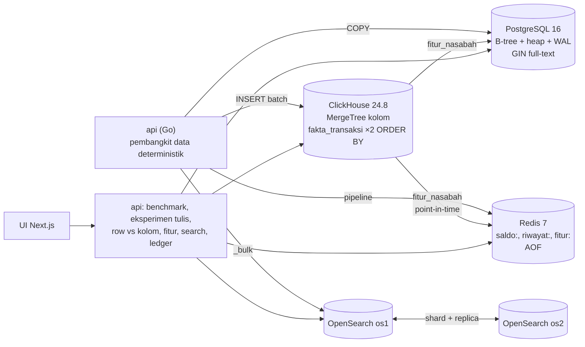

# Lab P07: storage engine, NoSQL, dan serving store

Demo kelas pertemuan 7 mata kuliah Data Engineering. Data transaksi bank syariah yang sama dimuat ke empat
store (PostgreSQL, ClickHouse, Redis, OpenSearch 2 node), lalu empat pola akses dari slide diukur di setiap
store. UI memperlihatkan latency p50/p95/p99, byte yang dibaca engine, amplifikasi tulis B-tree vs keluarga
LSM, row vs columnar, serving `fitur_nasabah` untuk tim AI, inverted index, dan hash chain jurnal akad.

Lab berdiri sendiri: API membangkitkan data deterministik dengan nama kolom kontrak platform
(`platform/KONTRAK-DATA.md`: `transaksi.occurred_at`, `kanal`, `jenis`, `nominal`, `rekening_id`, `cabang_id`;
gold `fakta_transaksi` dan `fitur_nasabah` seperti `platform/README-DATA.md`). Id memakai integer agar kunci
acak mudah dibangkitkan; platform memakai UUID.

Kaitan materi:

- Buku: `buku/bab/bab07-storage-engine-nosql-serving.tex`.
- Slide: `slides/P07-storage-engine-nosql-serving.tex`: Mulai dari pola akses (empat pertanyaan), B-tree,
  LSM-tree dan bloom filter, Tiga amplifikasi, Ragam NoSQL (key-value, search, PostgreSQL berekstensi),
  OLAP columnar (tabel transaksi di ClickHouse, `ORDER BY` dan sparse index), Polyglot persistence dan
  store untuk hot path, Serving store untuk layer gold, Immutable storage (hash chain, praktikum mini), dan
  Praktikum "mengukur dengan jujur" (P50/P99, empat pola akses, pasangan pola-store yang tidak masuk akal).
- Platform: gold di ClickHouse dan `gold.fitur_nasabah` adalah sumber yang di sini disalin ke serving store.

## Arsitektur



| Service | Image | Memori | Peran di demo |
|---|---|---|---|
| `postgres` | `postgres:16.4-alpine` | 512 MB | OLTP baris, B-tree (PK, `(nasabah_id, occurred_at)`), GIN full-text, `pageinspect`, jurnal hash chain |
| `clickhouse` | `clickhouse/clickhouse-server:24.8.14.39` | 1,5 GB | `fakta_transaksi` (ORDER BY nasabah_id, waktu), `fakta_transaksi_cabang` (ORDER BY cabang_id, waktu), `rekening`, `fitur_nasabah`, `tulis_uji` |
| `redis` | `redis:7-alpine` (7.4.7) | 256 MB | saldo per rekening, list 50 transaksi terakhir per nasabah, hash fitur per nasabah (TTL 2 hari), jangkar hash chain; AOF `everysec` |
| `os1`, `os2` | `opensearchproject/opensearch:2.19.1` | 900 MB per node (heap 384 MB) | index `transaksi` dan `rekening`: 2 shard × 1 replica |
| `api` | `de-bab07-api:1.0` (Go 1.24, pgx 5.7.5, go-redis 9.11.0) | 512 MB | pemuat data dan semua endpoint |
| `ui` | `de-bab07-ui:1.0` (Next.js 15.5, node 20) | 256 MB | UI demo |

Slide praktikum juga menyebut ScyllaDB (wide-column). ScyllaDB tidak dipasang agar RAM dan disk server lab
cukup; pola range scan per partition key diwakili PostgreSQL dengan indeks komposit dan ClickHouse dengan
`ORDER BY (nasabah_id, waktu)`.

Keamanan: security plugin OpenSearch dimatikan (`DISABLE_SECURITY_PLUGIN=true`) hanya untuk lab lokal.
Watermark disk dimatikan (`cluster.routing.allocation.disk.threshold_enabled=false`) karena disk server lab
hampir penuh; tanpa itu shard tidak dialokasikan dan cluster merah.

## Cara menjalankan

```bash
cd bab07-storage-engine-nosql-serving
cp .env.example .env          # ganti sandi contoh; BIND_ADDR=10.100.21.22 di server lab
docker compose up -d --build --wait
```

Setelah semua store sehat, API memuat 400 ribu transaksi (90 hari), 7.543 rekening, dan 5.000 nasabah ke
empat store (±1 menit), menghitung `fitur_nasabah`, dan mengisi jurnal akad contoh. UI menampilkan progres
pemuatan. Jumlah data diatur `JUMLAH_TRANSAKSI`, `JUMLAH_NASABAH`, `HARI` di `.env`.

| Port | Isi |
|---|---|
| 52700 | UI demo |
| 52701 | API (Go) |
| 52702 | ClickHouse HTTP (`/play`) |
| 52703 | OpenSearch os1 (REST, tanpa security, hanya `BIND_ADDR`) |

Uji otomatis dari keadaan bersih (±4 menit; `down -v` otomatis):

```bash
bash uji.sh
```

## Halaman UI

- **Benchmark pola akses** (`/`): tombol per pola (point lookup, range scan, aggregation, teks, lookup fitur)
  dan *Ukur semua*. Per pola: batang latency skala log (p50 tua, p95 muda), tabel p50/p95/p99, ops/detik,
  byte/baris yang dibaca engine (EXPLAIN BUFFERS PostgreSQL, `X-ClickHouse-Summary`), dan catatan pasangan
  yang tidak masuk akal (aggregation dan teks di Redis). Di bawahnya throughput tulis bulk dan tabel
  "kapan memilih".
- **B-tree vs LSM** (`/engine`): kedalaman dan jumlah page indeks B-tree (`bt_metap`), eksperimen tulis satu
  baris per operasi ke setiap store dengan amplifikasi tulis, grafik jumlah part ClickHouse yang naik lalu
  turun karena merge, dan simulasi LSM interaktif (memtable, flush, compaction L0/L1/L2, bloom filter).
- **Row vs columnar** (`/kolom`): ukuran heap PostgreSQL vs ClickHouse terkompresi, ukuran per kolom
  (terkompresi vs mentah), dan byte yang dibaca untuk empat query yang sama.
- **Serving fitur_nasabah** (`/fitur`): hitung ulang gold → salin ke Redis dan PostgreSQL, lookup satu
  nasabah dari empat cara (Redis, PostgreSQL, tabel fitur ClickHouse, hitung langsung dari fakta).
- **Search** (`/search`): node dan penempatan shard primary/replica, token dan panjang posting list, irisan,
  hasil BM25 dengan highlight, dan perbandingan dengan PostgreSQL ILIKE dan GIN.
- **Hash chain** (`/ledger`): rantai jurnal akad; sunting langsung di tabel, hitung ulang rantai untuk
  menutupi, dan bandingkan dengan jangkar di luar database.

## Contoh hasil (server lab, 400 ribu transaksi, n=200)

| Pola | PostgreSQL | Redis | ClickHouse | OpenSearch |
|---|---:|---:|---:|---:|
| point lookup saldo | 0,22 ms (3 page) | 0,08 ms | 2,89 ms (7.543 baris = 1 granule) | 2,54 ms |
| 50 trx terakhir nasabah | 0,54 ms (53 page) | 0,15 ms (list siap pakai) | 8,35 ms ORDER BY cocok (32.768 baris); 14,15 ms ORDER BY cabang (400.000 baris) | 12,01 ms |
| aggregation per cabang 30 hari | 35,9 ms (42 MB) | tidak masuk akal | 11,7 ms (2,9 MB) | 18,3 ms |
| teks "zakat" dan "wakaf" | ILIKE 127,6 ms; GIN 5,5 ms | tidak masuk akal | 17,5 ms (scan kolom) | 4,8 ms |
| lookup fitur nasabah | 0,22 ms | 0,10 ms | 3,9 ms tabel fitur; 8,3 ms hitung langsung | |

Throughput tulis bulk: ClickHouse ±290 ribu baris/detik, Redis ±200 ribu, PostgreSQL COPY ±120 ribu,
OpenSearch `_bulk` ±12 ribu (dengan replica). Tulis satu baris per operasi (300 baris): PostgreSQL
±430 ops/detik, WAL ±280 byte per baris (amplifikasi ±7×); ClickHouse ±430 INSERT/detik, 300 part baru
dan ±60 merge (amplifikasi ±2,3×, hanya menghitung byte terkompresi); Redis ±9.000 ops/detik, AOF ±120 byte
per operasi; OpenSearch ±60 ops/detik, segment dan translog di dua node (amplifikasi ±14×). Angka berubah
menurut beban mesin; yang dibahas di kelas adalah urutan besarnya.

## Skenario demo di kelas (±25 menit)

1. **Pola akses dulu, merek belakangan** (3 menit). Buka 52700. Tanyakan ke kelas: store mana tercepat?
   Klik *Ukur semua* (±20 detik). Tunjukkan bahwa jawabannya berbeda untuk setiap pola: Redis menang point
   lookup, ClickHouse menang aggregation, OpenSearch dan GIN menang teks.
2. **B-tree** (3 menit). Kolom "dibaca engine" point lookup PostgreSQL: 3 page. Buka *B-tree vs LSM*:
   `transaksi_pkey` 400 ribu kunci cukup 3 level karena tiap page memuat ±360 kunci. Hubungkan dengan slide
   "pohon lebar yang dangkal".
3. **Sparse index dan ORDER BY** (3 menit). Kembali ke range scan: dua tabel ClickHouse yang isinya sama.
   `ORDER BY (nasabah_id, waktu)` membaca 4 granule (32.768 baris); `ORDER BY (cabang_id, waktu)` membaca
   400.000 baris. Point lookup ClickHouse membaca satu granule penuh untuk satu kunci. Pesan slide:
   ORDER BY adalah keputusan desain, dan ClickHouse bukan pengganti OLTP.
4. **Row vs columnar** (3 menit). Halaman *Row vs columnar*: klik *Aggregation 3 kolom*. PostgreSQL membaca
   ±42 MB (semua kolom), ClickHouse ±3 MB. Klik *SELECT \* satu nasabah*: kebalikannya, PostgreSQL hanya
   ratusan KB. Tunjukkan rasio kompresi per kolom (`kanal` LowCardinality vs `trx_id`).
5. **Amplifikasi tulis** (5 menit). *B-tree vs LSM* → pilih PostgreSQL, 300 baris, *Tulis*: WAL per baris
   jauh lebih besar dari data logis. Pilih ClickHouse, *Tulis*: grafik part naik ke ratusan lalu turun
   karena merge (part_log: 300 part baru, puluhan merge). Ini anti-pattern yang disengaja; praktik benar
   INSERT batch. Lalu jalankan simulasi LSM: *Tulis 10 kunci acak* beberapa kali, amati flush dan
   compaction serta angka amplifikasi; *Baca* kunci untuk melihat bloom filter melewati SSTable.
6. **Search** (3 menit). Halaman *Search*: dua node, shard primary (biru tua) dan replica (biru muda) di
   node berbeda. Cari "zakat wakaf": posting list `zakat` dan `wakaf`, irisannya, dan waktu dibanding ILIKE.
   Pesan: OpenSearch indeks turunan, bukan sumber kebenaran; PostgreSQL GIN cukup untuk banyak kasus.
7. **Serving store untuk gold** (3 menit). Halaman *Serving fitur_nasabah*: klik *Hitung ulang dan
   sinkronkan* (ClickHouse → Redis ±0,2 detik untuk 5.000 nasabah), lalu *Nasabah acak*. Redis ±0,1 ms,
   menghitung dari fakta ±10 ms. Diskusikan TTL, versi, dan mengapa salinan harus bisa dibangun ulang.
8. **Hash chain** (2 menit). Halaman *Hash chain*: sunting entri 2, rantai merah; *hitung ulang seluruh
   rantai*: rantai hijau lagi tetapi tidak sama dengan jangkar. Pertanyaan: di mana jangkar disimpan?

## Pertanyaan diskusi

1. Mengapa point lookup di ClickHouse membaca 7.543 baris untuk satu saldo? Kapan itu tetap dapat diterima?
2. Redis memenangkan range scan karena list sudah disiapkan. Apa harga yang dibayar (memori, sinkronisasi,
   query baru yang tidak terduga)?
3. PostgreSQL dengan GIN hampir secepat OpenSearch untuk teks. Kapan Anda tetap memilih OpenSearch?
4. Amplifikasi tulis PostgreSQL di eksperimen dihitung dari WAL, ClickHouse dari byte part terkompresi.
   Apa yang tidak tercakup (checkpoint, full-page write, merge berikutnya) dan bagaimana mengukurnya lebih
   jujur?
5. Untuk saldo, notifikasi, penghitung fraud per menit, dan dashboard direksi: pilih store dan sebutkan
   pilihan CAP/PACELC masing-masing.
6. Fitur "hitung langsung" berbeda nilainya dari fitur point-in-time. Apa risikonya bila training memakai
   yang satu dan serving memakai yang lain?

## Struktur

```
compose.yaml, .env.example, uji.sh
postgres/01-skema.sql        tabel OLTP, fitur_nasabah, tulis_uji, jurnal_akad, ekstensi pageinspect
clickhouse/config.d/lab.xml  cache kecil, part_log 1 detik; users.d/batas.xml batas memori query
api/                         Go: stores (koneksi), muat (pembangkit + pemuat), bench, engine, kolom, fitur,
                             search, ledger, main; logika_test.go (persentil, determinisme data, hash chain)
ui/                          Next.js: benchmark, engine (+ simulasi LSM), kolom, fitur, search, ledger
```

## Log

API menulis log JSON satu baris (`time`, `level`, `msg`, `service=bab07-api`, `request_id`), termasuk satu
baris per hasil benchmark (`pola`, `store`, `p50_ms`, `p95_ms`) dan per eksperimen tulis. Di Grafana
`shared/observability` (52900): Explore → Loki → `{compose_project="de-bab07"} | json | msg="bench"`.
Tanpa Grafana: `docker compose logs -f api`.

## Pembersihan

```bash
docker compose down -v
docker builder prune -f
```
