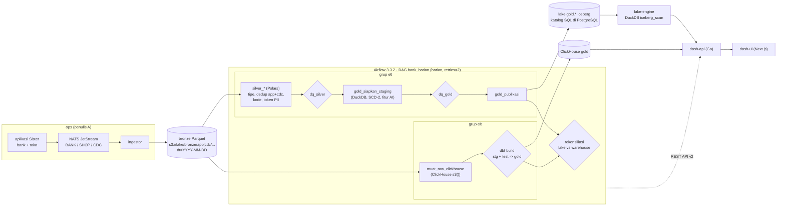

# Platform DE: bagian data (pipeline, lake, warehouse, dashboard)

Bagian ini mengolah bronze yang ditulis ingestion (penulis A, lihat `KONTRAK-DATA.md`) menjadi gold
di dua tempat, lalu menyajikannya di dashboard direksi. Ini contoh proyek UTS Data Engineering
(slide P08, jalur A bank syariah digital) dan memakai materi Bab 4 (lakehouse dan medallion), Bab 5
(ETL satu mesin), Bab 6 (orkestrasi, dbt, data quality), dan Bab 7 (serving store).

Orkestrasi utama Apache Airflow 3.3.2. Satu DAG harian `bank_harian` menjalankan dua jalur dari bronze
yang sama:

- **ETL**: Polars/DuckDB/PyArrow mentransformasi bronze di luar warehouse, hasilnya dimuat ke data lake
  Iceberg `lake.silver.*` lalu `lake.gold.*` di RustFS.
- **ELT**: bronze dimuat mentah ke ClickHouse (database `raw`), lalu ditransformasi di dalam warehouse
  dengan dbt (`dbt-clickhouse`) menjadi database `gold`.

Kedua gold memakai star schema yang sama dan direkonsiliasi di akhir DAG. Dashboard bisa memilih
sumber jawaban: warehouse (ClickHouse) atau lake (DuckDB atas Iceberg).

## Arsitektur



Pola write-audit-publish di jalur ETL: gold dibangun dulu di `lake.staging.*`, diperiksa `dq_gold`,
baru disalin ke `lake.gold.*`. Di jalur ELT, `dbt build` dijalankan dua tahap: model staging beserta test-nya
lebih dulu sebagai gerbang, lalu seed, model gold, dan test gold hanya bila tahap pertama lulus.

### Kapan ETL, kapan ELT

| Pertimbangan | ETL (Polars/DuckDB -> lake) | ELT (raw -> dbt di ClickHouse) |
|---|---|---|
| Letak transformasi | mesin terpisah (worker Airflow) | di dalam warehouse |
| PII | sudah di-tokenize sebelum mendarat di silver; nilai mentah tidak pernah tersimpan di lake | `raw` berisi PII mentah; akses database `raw` harus dibatasi |
| Cocok bila | logika lebih nyaman di Python, data perlu dibersihkan/disensor sebelum disimpan, hasil dipakai banyak engine (Iceberg netral engine), biaya compute warehouse mahal | data sudah relasional, analis menulis SQL, ingin test dan lineage bawaan dbt, warehouse kuat dan murah untuk transformasi |
| Ulang transformasi | baca ulang bronze dari object storage | `raw` sudah di warehouse, cukup `dbt build` |
| Kelemahan | dua salinan logika bila ada konsumen SQL | warehouse menyimpan data mentah (biaya, risiko PII) |

Di platform ini ETL dipilih untuk lake karena silver/gold Iceberg dibaca banyak engine (DuckDB, nanti
Spark di UAS) dan PII harus hilang sebelum disimpan. ELT dipilih untuk warehouse karena dashboard
membaca ClickHouse dan analis bisnis bekerja dengan SQL/dbt.

## Service dan versi

| Service | Image | Port host | Fungsi |
|---|---|---|---|
| data-pg | `postgres:16.4-alpine` | - | metadata Airflow (db `airflow`) + katalog Iceberg SQL (db `iceberg`) |
| airflow-apiserver | `de-platform-data:1.0` (dari `apache/airflow:slim-3.3.2-python3.12`) | 52010 | UI + REST API v2 |
| airflow-scheduler | sama | - | LocalExecutor (task berjalan di sini) |
| airflow-dag-processor | sama | - | parsing DAG |
| airflow-init, data-init, muat-awal | sama | - | sekali jalan: migrasi DB; namespace/database/lifecycle/cost; run muat awal |
| lake-engine | sama | - | DuckDB 2.0 atas Iceberg (`iceberg_scan`) untuk dashboard |
| clickhouse | `clickhouse/clickhouse-server:24.8.14.39` | 52011 | warehouse (`raw`, `stg`, `gold`, `meta`) |
| dash-api | `de-platform-dash-api:1.0` (Go 1.24, alpine 3.20) | 52013 | API dashboard, log JSON |
| dash-ui | `de-platform-dash-ui:1.0` (Next.js 15.5, node 20) | 52012 | UI dashboard |

Isi virtualenv data di image Airflow (`data/airflow/requirements-data.txt`): dbt-core 1.12.7,
dbt-clickhouse 1.10.3, polars 2.0.0, duckdb 2.0.0 (+ ekstensi httpfs, iceberg, avro), pyarrow 26.0.0,
pyiceberg 0.12.0, clickhouse-connect 1.13.0, boto3 1.44.9. Satu image dipakai semua komponen Python
agar disk hemat.

## Pemetaan W1-W10

| W | Bukti di platform |
|---|---|
| W1 | bronze milik ops; `cek_bronze` memeriksa partisi `dt`; metadata `_ingested_at`, `_source`, `_batch_id` dipakai dedup dan uji timeliness |
| W2 | `pipeline/silver.py`: tipe dari `kolom.py` (string, epoch Debezium, RFC3339 diseragamkan), dedup app vs cdc (`_source` = `app`/`cdc`/`app+cdc`), kanal dan kode akad distandardkan, akad tidak valid ke `silver.akad_karantina`, NIK/no HP/email/alamat jadi token `tok_...` (SHA-256 + pepper), nama disamarkan |
| W3 | star schema `fakta_transaksi` (grain satu transaksi), `fakta_pembiayaan` (grain satu akad cair), `dim_tanggal`, `dim_cabang`, `dim_kanal`, `dim_akad`, `dim_nasabah`; di lake dan warehouse |
| W4 | `dim_nasabah` SCD-2 dari riwayat CDC (window function), fakta mencari versi dengan ASOF JOIN |
| W5 | semua silver/gold lake berformat Iceberg; halaman Time travel + `iceberg_scan(..., snapshot_from_id)` |
| W6 | DAG `bank_harian` harian 00.00 WIB, `retries=2` (task DQ tidak di-retry) |
| W7 | Iceberg overwrite per partisi dalam satu transaksi; ClickHouse `REPLACE PARTITION`/`EXCHANGE TABLES`; dbt `table` dibangun ulang atomik; uji Q1/Q3 |
| W8 | 21 test ETL + 28 test dbt + 1 rekonsiliasi ETL vs ELT, lima dimensi, gerbang sebelum gold; hasil di `meta.dq_hasil` dan halaman Data quality |
| W9 | lifecycle rule di bucket `lake`, kebijakan tertulis di bawah, `pipeline/cost.py` + halaman Tiering & cost |
| W10 | gold dimuat ke ClickHouse (serving) dan dibaca dashboard; empat pertanyaan direksi dari dua sumber |

## Sumber dan kolom (kontrak revisi 23 Nov)

Aplikasi operasional adalah aplikasi microservices Sister bab05 (toko + bank). Bagian data membaca
entitas bank di bronze (`cabang`, `nasabah`, `rekening`, `transaksi`, `akad_pembiayaan`) dari sumber
`app` (stream BANK) dan `cdc` (Debezium). Nama kolom kontrak (`occurred_at`, `pokok`, `cair_at`,
`created_at`, `dibuka_at`, `jenis` rekening) dipetakan ke kolom silver di `pipeline/kolom.py`; nama
lama tetap diterima sebagai alias. Jalur ELT memuat semua kolom apa adanya sebagai String dan dbt
memakai `coalesce(nama_kontrak, alias)`. Kanal `ecommerce` dan jenis `bayar_belanja` (dengan
`ref_order_id`) dipakai fitur belanja. Akad masuk `fakta_pembiayaan` hanya bila kodenya valid dan
statusnya `cair`/`lunas`; cabang akad diambil dari versi nasabah yang berlaku saat cair. Pencairan juga muncul sebagai transaksi `transfer_masuk` ber-`akad_id`
(fakta_transaksi mendapat `akad_key`), tetapi pertanyaan "pembiayaan cair per akad" memakai
`akad_pembiayaan.cair_at` agar satu akad dihitung sekali. Data terlambat ditandai `_terlambat` bila
`created_at - occurred_at > 1 menit` (test timeliness berkeparahan peringatan). `idempotency_key` dan
`transfer_id` dibawa ke silver; request ulang tanpa idempotency key menjadi dua transaksi dan ditangkap
test duplikat bisnis. Entitas toko
(`orders`, `payment`, `product`) belum diolah: belanja nasabah sudah terwakili oleh transaksi
`bayar_belanja`.

## Data quality (gerbang)

| Dimensi | ETL (`pipeline/dq.py`) | ELT (dbt) |
|---|---|---|
| completeness | kolom wajib transaksi terisi; setiap tanggal punya transaksi | `not_null` trx_id, rekening_id, cabang_id, waktu, nominal, nasabah_id; `stg_volume_per_hari` |
| uniqueness | trx_id unik di silver; grain fakta unik; satu versi aktif per nasabah; grain fitur unik; duplikat bisnis 60 detik (peringatan) | `unique` trx_id, akad_id, nasabah_sk; `gold_dim_nasabah_satu_versi_aktif`; `gold_fitur_grain_unik`; `stg_duplikat_bisnis` (peringatan) |
| validity | kanal dalam domain; 0 < nominal <= 5 M; tidak ada NIK mentah di silver; rasio karantina akad (peringatan); SCD-2 tanpa celah; akad fakta valid; fitur point-in-time | `accepted_values` kanal dan akad; `rentang_nilai` nominal; `stg_tanpa_nik_mentah`; `gold_dim_nasabah_scd2_tanpa_celah`; `gold_fitur_point_in_time`; `stg_rasio_karantina_akad` (peringatan) |
| consistency | nominal app = cdc; cabang transaksi terdaftar; fakta menemukan versi nasabah dan cabang; rekonsiliasi silver vs gold | `relationships` cabang dan nasabah_sk; `stg_app_cdc_konsisten`; `gold_rekonsiliasi_stg_vs_fakta`; task `rekonsiliasi_lake_vs_warehouse` |
| timeliness | partisi tgl sudah ada di gold (error); p95 latensi ingest <= 60 menit (peringatan) | `stg_latensi_ingest_p95` (peringatan) |

Latensi ingest berkeparahan peringatan karena data backfill historis dari generator memang
berlatensi besar; ubah `DQ_LATENSI_KEPARAHAN=error` untuk data live. Pesan gagal menyebut aturan,
jumlah pelanggar, dan contoh baris (trx_id dan nilai yang salah).

## Fitur untuk tim AI: `gold.fitur_nasabah`

Grain satu nasabah per `tgl_fitur`. Kolom: `trx_7h`, `nominal_7h`, `trx_30h`, `nominal_30h`,
`hari_sejak_trx_terakhir`, `rasio_digital_30h` (mobile/web/ecommerce), `belanja_ecom_30h`,
`nominal_belanja_ecom_30h`, `akad_cair_kumulatif`, `pokok_cair_kumulatif`, `umur_nasabah_hari`,
serta `segmen_saat_itu`, `kota_saat_itu`, `nasabah_sk_saat_itu`.

Point-in-time: jendela window function berakhir di `CURRENT ROW` (hari D), sehingga fitur hari D
tidak pernah memakai kejadian sesudah D, dan atribut profil diambil dari versi SCD-2 yang berlaku
pada akhir hari D (ASOF JOIN). Dataset training yang digabung dengan label pada tanggal D aman dari
kebocoran data masa depan. Logika ditulis dua kali (DuckDB SQL di `pipeline/gold.py`, ClickHouse SQL
di `dbt/bank_elt/models/gold/fitur_nasabah.sql`) dan direkonsiliasi. Pemeriksaan manual:
`checks/fitur_point_in_time.sql`. Rekonsiliasi fitur hanya membandingkan tanggal yang jendela 30 harinya sudah
lengkap di lake (silver hanya berisi tanggal yang sudah diproses, sedangkan `raw` ikut memuat partisi
dt tetangga); sesudah muat awal semua tanggal memenuhi syarat.

## Kebijakan tiering (W9)

| Data | Warm (S3 Standard) | Cold (Glacier Instant Retrieval) | Archive (Glacier Flexible) | Dihapus |
|---|---|---|---|---|
| bronze | 0-13 bulan | 13-24 bulan | 24 bulan-10 tahun | sesudah 10 tahun |
| silver (Iceberg) | 0-13 bulan | sesudah 13 bulan | - | lewat Iceberg (hapus partisi + expire_snapshots) |
| gold (Iceberg, ClickHouse) | selama dipakai dashboard | - | - | dibangun ulang dari silver |

Alasan: dashboard pagi membaca gold setiap hari (warm). Analisis tahunan membaca dua tahun terakhir,
jadi data 13-24 bulan harus tetap bisa di-query seketika (Glacier Instant Retrieval, bukan Glacier
Flexible). Bronze lebih dari dua tahun hanya dibutuhkan untuk audit dan pemrosesan ulang, boleh
menunggu 3-5 jam (archive). Retensi 10 tahun mengikuti kewajiban penyimpanan dokumen perusahaan
(UU 8/1997); sesuaikan bila kebijakan internal bank menetapkan lain.

Data Iceberg tidak boleh dihapus dengan expiration lifecycle: metadata masih menunjuk berkas itu dan
tabel menjadi rusak. Penghapusan silver/gold dilakukan lewat Iceberg.

Yang terpasang di RustFS 1.0.4 (`data-init`, `pipeline/tiering.py`):
- RustFS menerima aturan Transition hanya ke tier remote yang sudah didaftarkan admin; tanpa tier,
  PutBucketLifecycle ditolak (`invalid tier`). RustFS juga membatasi satu Transition per rule.
- Karena itu `data-init` mencoba `tiering/lifecycle-rustfs-transisi.json` lebih dulu, lalu memasang
  `tiering/lifecycle-rustfs.json`: expiration `bronze/` 3650 hari dan pembatalan multipart 7 hari.
- Konfigurasi produksi (S3) dengan transisi lengkap: `tiering/lifecycle-produksi-s3.json`.
- Simulasi: halaman Tiering menghitung tier setiap objek bila "hari ini" digeser 0/400/760/3700 hari.

## Cost 3 tahun

Model slide P08: `B_m = Σ_t V(t,m)·h_t + R_m·h_ambil + E_m·h_egress`, dihitung per kohort bulanan
(`pipeline/cost.py`, tabel `meta.cost_bulanan`). Harga AWS S3 region Jakarta (ap-southeast-3) dari
Price List API (offer AmazonS3 publikasi 21 Nov 2026, AWSDataTransfer 19 Nov 2026), diakses 23 Nov 2026:
Standard 0,025; Glacier Instant Retrieval 0,005 (+0,03/GB diambil); Glacier Flexible 0,0045
(+0,012/GB ambil standar); egress internet 0,132 USD/GB sesudah 100 GB gratis. Glacier Deep Archive
tidak tersedia di region Jakarta.

Asumsi: bronze 1 GB/hari, tumbuh 5%/bulan, silver 50% dan gold 20% dari bronze, analisis tahunan
membaca 24 bulan silver, egress 150 GB/bulan, kurs asumsi Rp16.500/USD.

| Skenario | Laju | Total 3 tahun (USD) | ≈ Rp | Bulan 36 (USD/bulan) |
|---|---|---:|---:|---:|
| semua_hot | 1x | 1.885,62 | 31,1 juta | 128,79 |
| kebijakan | 1x | 1.533,04 | 25,3 juta | 102,75 |
| paling_hemat | 1x | 849,13 | 14,0 juta | 79,63 |
| semua_hot | 2x | 3.533,64 | 58,3 juta | 250,98 |
| kebijakan | 2x | 2.828,48 | 46,7 juta | 198,89 |
| paling_hemat | 2x | 1.460,66 | 24,1 juta | 152,66 |

Kebijakan sama mahalnya dengan semua_hot selama 13 bulan pertama dan mulai lebih murah pada bulan
ke-14. Skenario paling hemat (bronze langsung archive, silver langsung cold sesudah sebulan) lebih
murah, tetapi bronze sebulan terakhir pun butuh restore 3-5 jam untuk pemrosesan ulang dan setiap
analisis membayar biaya ambil. Ubah asumsi dengan `COST_BRONZE_GB_HARI`, `COST_TUMBUH_PER_BULAN`,
`COST_EGRESS_GB_BULAN`, lalu `python -m pipeline.cost --markdown`.

## Cara menjalankan

Seluruh platform (dari folder `platform/`, `.env` berisi variabel ops dan data; contoh bagian data di
`data/.env.data.example`):

```bash
cp data/.env.data.example .env     # gabungkan dengan contoh ops, lalu ganti semua nilai contoh
docker compose up -d --build       # compose.yaml = Sister + ops + data
```

Saat menyala, `muat-awal` memicu run penuh (semua tanggal bronze s.d. kemarin) lalu mengaktifkan
jadwal harian. Bagian data saja dengan bronze sintetis (tanpa ops):

```bash
docker compose -p de-platform-b -f compose.data.yaml -f data/dev/compose.dev.yaml up -d --build
```

Uji otomatis: `data/uji-data.sh` (`UJI_MODE=dev` bronze sintetis, `UJI_MODE=e2e` seluruh platform).

| Port | Isi |
|---|---|
| 52010 | Airflow UI (user/sandi dari `.env`) |
| 52011 | ClickHouse HTTP (`/play` untuk query) |
| 52012 | UI dashboard |
| 52013 | API dashboard |

Log: Airflow menulis log task ke volume `airflow-logs`; pipeline Python, lake-engine, dan dash-api
menulis log JSON satu baris (`time`, `level`, `msg`, `service`, `run_id`/`request_id`) sehingga
terbaca Grafana di `shared/observability`.

## Skenario demo di kelas (±15 menit)

1. **Arsitektur** (2 menit): buka Airflow 52010, DAG `bank_harian`, Graph view. Tunjukkan grup `etl`
   dan `elt` berdampingan dan gerbang DQ di masing-masing jalur. Buka halaman *Lineage* di 52012 untuk
   jumlah baris setiap lapisan.
2. **Empat pertanyaan direksi** (3 menit): halaman utama, tanggal acuan kemarin. Ganti sakelar
   *Warehouse* ke *Lake*, lalu *Bandingkan*: hasil identik, latency berbeda. Tanyakan ke mahasiswa
   mengapa ClickHouse lebih cepat untuk agregasi ini dan kapan DuckDB atas Iceberg cukup.
3. **Q1** (2 menit): halaman *Tiga uji demo*, jalankan run 1 lalu run 2 untuk kemarin. Tabel per tgl
   tidak berubah; halaman *Time travel* menunjukkan snapshot baru dengan isi yang sama.
4. **Q2** (3 menit): sisipkan data rusak untuk kemarin, jalankan DAG. Di Airflow `dq_silver` merah,
   `gold_publikasi` upstream_failed, `dbt_build_gold` merah. Halaman *Data quality* menunjukkan aturan
   yang dilanggar dan contoh baris (kanal `satelit`, rekening kosong, nominal negatif, nominal app
   berbeda dengan cdc). Snapshot gold dan part ClickHouse tidak berubah. Pulihkan, jalankan lagi.
5. **Q3** (2 menit): backfill 7 hari dari halaman uji atau Airflow, lalu ulangi. Kolom selisih nol,
   `baris = trx_unik`.
6. **SCD-2 dan fitur AI** (2 menit): `checks/scd2_nasabah_berubah.sql` di ClickHouse `/play`; halaman
   *Fitur untuk tim AI*, riwayat satu nasabah, perhatikan `nasabah_sk_saat_itu` berganti saat profil
   berubah.
7. **Tiering** (1 menit): geser hari ke 760: bronze pindah ke archive. Tunjukkan grafik cost dan
   bulan ke-14.

Pertanyaan yang bisa diajukan: mengapa partisi per hari; apa yang mencegah duplikat bila task di-retry
(overwrite partisi + dedup `trx_id`); di tier mana bronze berumur dua tahun dan berapa biaya serta
waktu mengambilnya kembali.

## Struktur

```
compose.data.yaml
data/
  airflow/        Dockerfile (satu image), requirements-data.txt, mulai.sh
  dags/           bank_harian.py
  pipeline/       silver, gold (+fitur), dq, elt_raw, dbt_jalan, rekonsiliasi, lake_engine, tiering, cost,
                  siapkan (data-init), muat_awal, sabotase (uji Q2), uji_cli
  dbt/bank_elt/   staging (view), gold (tabel), seeds, tests
  clickhouse/     named collection lake_s3 (kredensial dari env), izin user
  dashboard/      api (Go, stdlib) dan ui (Next.js)
  tiering/        lifecycle RustFS dan produksi S3
  checks/         query pemeriksaan Q1-Q3, SCD-2, fitur point-in-time
  dev/            bronze sintetis + compose pengganti ops
  uji-data.sh
```

## Pembersihan

```bash
docker compose down -v && docker builder prune -f
```
