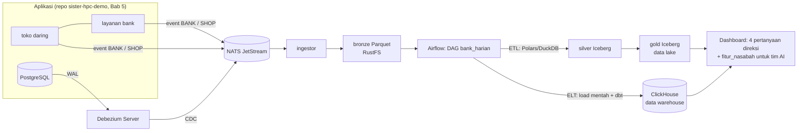

# Platform end-to-end Data Engineering (contoh proyek UTS)

Platform ini menjalankan aliran data lengkap untuk skenario UTS jalur A (bank syariah digital, slide P08):



Aplikasi operasional adalah aplikasi microservices mata kuliah Sistem Terdistribusi (Bab 5, toko daring +
layanan bank). Clone kedua repo berdampingan:

```bash
git clone https://github.com/situkangsayur/sister-hpc-demo.git
git clone https://github.com/situkangsayur/de-demo.git
cd de-demo/platform
cp .env.example .env            # ganti semua nilai contoh; BIND_ADDR=10.100.21.22 di server lab
docker compose up -d --build    # aplikasi + ingestion + pipeline + dashboard
```

| Bagian | Dokumentasi | UI |
|---|---|---|
| Aplikasi bank + toko | `../../sister-hpc-demo/bab05-microservices-messaging/README.md` | 50500 |
| Ingestion (Debezium, NATS, ingestor, generator lalu lintas) | [README-OPS.md](README-OPS.md), [ops/SKEMA.md](ops/SKEMA.md) | 52000 (aliran data), 52004 (RustFS) |
| Pipeline dan serving (Airflow ETL/ELT, Iceberg, ClickHouse, dbt, data quality, tiering, dashboard) | [README-DATA.md](README-DATA.md) | 52010 (Airflow), 52012 (dashboard) |
| Kontrak data antarbagian | [KONTRAK-DATA.md](KONTRAK-DATA.md) | |

Uji: `bash ops/uji-ops.sh` (ingestion) dan `bash data/uji-data.sh` (pipeline; dengan seluruh platform bila
aplikasi Sister tersedia). Log: `shared/observability` (Grafana 52900).
